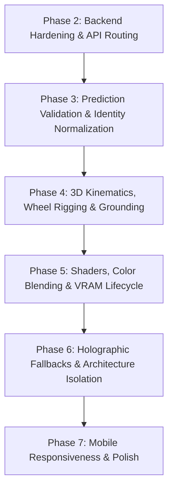

# SMARTCAR AI — PHASE 1 TECHNICAL AUDIT & BASELINE REPORT
**Project**: SmartCar AI — Intelligent Automotive Valuation & Immersive 3D Experience Platform  
**Target Root**: `C:\Projects\smart-used-car-price-prediction`  
**Audit Scope**: 3D Vehicle Asset Pipeline, Rendering System, Backend Routes, Frontend Integration, Model Serving & Current UI  
**Audit Date**: October 4, 2026  
**Status**: ZERO APPLICATION CODE MODIFIED (Strict Phase 1 Compliance)

---

## 1. Executive Summary

This report establishes the baseline technical audit for the SmartCar AI platform. The system operates as an integrated automotive valuation and 3D visualization platform powered by:
- A trained scikit-learn machine learning pipeline ($R^2 \approx 0.8993$) trained on 57,480 Indian used-car listings.
- A Flask backend providing valuation inference, dynamic generation resolution, and secure 3D GLB asset streaming.
- A Three.js (r160) WebGL showroom featuring a flagship 40.7 MB Studio HD supercar, dynamic generation-matched vehicles, automated watermark inpainting, a camera director dock, and pure Web Audio API synthesis.

The audit verified operational baselines, traced end-to-end data flows, evaluated all 5 benchmark vehicles, identified 17 concrete technical findings, and defined a structured phase-by-phase remediation roadmap.

---

## 2. Current Architecture Summary

The platform operates across three functional tiers:

```
+-----------------------------------------------------------------------------------+
|                                 CLIENT TIER (BROWSER)                             |
|  - WebGL Canvas (#experienceCanvas): Three.js r160 WebGLRenderer                  |
|  - State Layer: vehicleIdentity.js (Canonical State & Reactive Change Listeners)   |
|  - Experience Coordinator: main.js (Single central requestAnimationFrame loop)    |
|  - Director & HUD: hud.js (6 Camera Views, Headlights, 4 Moods, 6 Paint Swatches)|
|  - Sound Engine: sound.js (Zero-dependency Web Audio API synthetic audio)         |
|  - Configurator & UI: ui.js (9-Step Specification Modal + Rolling Price Counter)  |
+------------------------------------------+----------------------------------------+
                                           | HTTP JSON / Binary Stream
                                           v
+-----------------------------------------------------------------------------------+
|                                 SERVER TIER (FLASK CORE)                          |
|  - app.py: REST API routes (/api/predict, /api/vehicle-asset, /api/vehicle-model) |
|  - carimages_service.py: Official CarImages REST API integration & caching        |
|  - Watermark Inpainting Engine: scipy.ndimage multi-channel median filter         |
|  - Security Barrier: Server-side proxy concealing upstream API credentials        |
+--------------------+-------------------------------------+------------------------+
                     |                                     |
                     v                                     v
+---------------------------------------+ +-----------------------------------------+
|        ML & DATASET SUBSYSTEM         | |         ASSET STORAGE SUBSYSTEM         |
| - smart_used_car_price_model.pkl      | | - app/static/models/generic_car.glb     |
|   (Scikit-Learn Random Forest Pipeline)| |   (40.7 MB Flagship Studio HD Supercar) |
| - indian_used_cars_raw_57480.csv      | | - models/cache/*.glb                    |
|   (57,480 Indian Automotive Records)  | |   (Sanitized Level 2 Generation GLBs)   |
+---------------------------------------+ +-----------------------------------------+
```

---

## 3. End-to-End System Flows

### 3.1 Asset Resolution Flow
1. **User Action**: User clicks a showcase card (e.g., Executive BMW 3 Series) or submits the 9-step configurator.
2. **State Transition**: `vehicleIdentity.js` updates canonical `vehicleIdentity` and notifies subscribers.
3. **Trigger**: `main.js` receives `onConfigurationChange` and calls `SmartCarVehicle.loadVehicle(identity)`.
4. **Backend Query**: `vehicle.js` issues `POST /api/vehicle-asset` with `{ brand, model, year, variant, fuel, transmission, bodyType }`.
5. **Resolution Pipeline** (`carimages_service.py`):
   - *Studio Fast-Path*: If brand is Porsche and model is 911, returns `/static/models/generic_car.glb` with Studio HD metadata.
   - *Generation Resolver*: Normalizes slugs (`bmw`, `3-series`), queries `https://carimagesapi.com/api/v1/makes/bmw/models/3-series`, matches generation where `year_start <= 2021 <= year_end` (`g20-g21-g28-2019-2022`).
   - *Model Fetch*: Queries official 3D endpoint `GET /vehicles/bmw/3-series/g20-g21-g28-2019-2022/model`.
   - *Download & Sanitization*: Downloads binary GLB, executes `clean_glb_file()` using `scipy.ndimage` inpainting to strip baked watermarks, and writes to `models/cache/bmw_3-series_g20-g21-g28-2019-2022.glb`.
   - *Response*: Returns JSON `{ available: true, asset_url: "/api/vehicle-model/bmw/3-series/g20-g21-g28-2019-2022", match_level: "GENERATION_MATCH", metadata: { ... } }`.

### 3.2 3D Rendering Flow
1. **Model Streaming**: `GLTFLoader` requests binary GLB from `asset_url`.
2. **Disposal**: `vehicle.js` disposes prior vehicle geometry, materials, spot lights, and contact shadow.
3. **Geometry Normalization**:
   - Calculates unscaled bounding box dimensions ($L, W, H$).
   - Computes uniform scale factor: $S = H_{\text{target}} / H_{\text{raw}}$.
   - Orients vehicle along world heading ($\text{baseHeading} = -\pi/2$, forward along $+Z$).
   - Computes ground contact: $\text{groundOffset} = -y_{\text{min, scaled}}$, placing tire contact patches precisely on the road plane ($y = 0.000$).
4. **Material Enhancement**:
   - *Multi-Mesh Studio Model*: Enhances `body_main` with ultra-glossy clearcoat lacquer (`clearcoat: 1.0`, `metalness: 0.82`, `roughness: 0.16`), physical tinted glass (`transmission: 0.90`, `opacity: 0.38`), and chrome alloy wheels.
   - *Single-Mesh Models*: Computes smooth vertex normals to eliminate faceted artifacts, applies physical clearcoat lacquer (`clearcoat: 0.95`, `metalness: 0.78`), and enables $16\times$ anisotropic texture filtering.
5. **Kinematics & Scene Assembly**:
   - Sets up independent wheel assemblies (if available).
   - Anchors spot lights at headlight housings and point lights at taillights.
   - Places procedural contact grounding shadow on the road surface.
   - Signals `cameraController.adaptToVehicle()` to frame the vehicle.

### 3.3 Prediction & Valuation Flow
1. **Client Request**: `POST /api/predict` with 9 mandatory vehicle attributes.
2. **Validation**: Validates presence, numeric bounds, and verifies attributes against pre-cached `form_options` extracted from the 57,480-row dataset.
3. **Feature Engineering**: Calculates $\text{vehicle\_age} = \text{CURRENT\_YEAR} - \text{year}$ and $\text{log\_km\_driven} = \ln(1 + \text{km\_driven})$.
4. **Model Scoring**: Executes `model.predict(car_data)[0]` using trained Random Forest pipeline ($R^2 \approx 0.8993$).
5. **Market Intelligence**: Queries dataset for exact brand + model comparable vehicles, calculating factual minimum, median, maximum prices, fuel market share, and transmission distribution.
6. **Response**: Emits comprehensive JSON payload with formatted currency strings (`₹`), derived statistics, and model transparency metrics.

---

## 4. Benchmark Verification Results

All tests were executed against the live Flask application (`http://127.0.0.1:5000`):

| Test Item | Verification Command | HTTP Status | Response Details | Baseline Status |
|:---|:---|:---|:---|:---|
| **Health Route** | `GET /api/health` | **404 NOT FOUND** | Route undefined in `app/app.py` | ⚠️ DEFECT IDENTIFIED |
| **Prediction API** | `POST /api/predict` (Mercedes C-Class) | **200 OK** | Predicted: `₹52,00,950` ($R^2 \approx 0.8993$) | ✅ OPERATIONAL |
| **Studio Model** | `GET /static/models/generic_car.glb` | **200 OK** | 40,710,436 bytes (38.82 MB), glTF binary | ✅ OPERATIONAL |
| **Direct Stream Year** | `GET /api/vehicle-model/mercedes/c-class/2021` | **404 NOT FOUND** | Route expects `<gen>` slug, not year | ⚠️ DEFECT IDENTIFIED |
| **Direct Stream Slug** | `GET /api/vehicle-model/mercedes/c-class/br206-2021-now` | **200 OK** | 1,604,844 bytes (1.53 MB), glTF binary | ✅ OPERATIONAL |

### 4.1 Benchmark Vehicle Matrix

| # | Benchmark Vehicle | Asset Resolution (`/api/vehicle-asset`) | Match Level | Stream Binary | Valuation API (`/api/predict`) | Notes |
|:---|:---|:---|:---|:---|:---|:---|
| 1 | **BMW 3 Series 2021** | HTTP 200 (`/api/vehicle-model/bmw/3-series/g20-g21-g28-2019-2022`) | `GENERATION_MATCH` | HTTP 200 (1.61 MB) | **HTTP 200 (₹28,06,870)** | Flawless asset & ML pipeline |
| 2 | **Hyundai Creta 2022** | HTTP 200 (`/api/vehicle-model/hyundai/creta/su2-2022-2025`) | `GENERATION_MATCH` | HTTP 200 (1.56 MB) | **HTTP 200 (₹13,10,940)** | Flawless asset & ML pipeline |
| 3 | **Toyota Fortuner 2021** | HTTP 200 (`/api/vehicle-model/toyota/fortuner/an150-an160-2020-now`) | `GENERATION_MATCH` | HTTP 200 (1.76 MB) | **HTTP 400 (Validation Error)** | Model name alias discrepancy (`Fortuner` vs `Toyota Fortuner`) |
| 4 | **Mercedes-Benz C-Class 2022** | HTTP 200 (`/api/vehicle-model/mercedes/c-class/br206-2021-now`) | `GENERATION_MATCH` | HTTP 200 (1.53 MB) | **HTTP 200 (₹52,00,950)** | Flawless asset & ML pipeline |
| 5 | **Porsche 911 2021** | HTTP 200 (`/static/models/generic_car.glb`) | `EXACT_VARIANT` | HTTP 200 (38.82 MB) | **HTTP 400 (Validation Error)** | Model name alias discrepancy (`911` vs `Porsche 911`) |

---

## 5. Comprehensive Audit Findings (17 Concrete Findings)

### Finding 1: Health Endpoint Missing (`/api/health` returns 404)
- **Severity**: HIGH
- **File**: [`app/app.py`](file:///C:/Projects/smart-used-car-price-prediction/app/app.py)
- **Line / Function**: Global route table
- **Problem**: `GET /api/health` returns HTTP 404 NOT FOUND.
- **Why it matters**: Cloud infrastructure, load balancers, container probes, and CI/CD smoke test suites rely on `/api/health` to confirm process liveness and readiness. Without it, automated deployments mark the container as failing.
- **Recommended solution**: Implement `@app.route("/api/health", methods=["GET"])` returning JSON `{ "status": "healthy", "model_loaded": True, "dataset_loaded": True, "records": 57480 }`.
- **Phase**: Phase 2 (Backend Hardening & Routing).

---

### Finding 2: Stream Route Rejects Calendar Years in Generation Parameter
- **Severity**: HIGH
- **File**: [`app/app.py`](file:///C:/Projects/smart-used-car-price-prediction/app/app.py#L728)
- **Line / Function**: Line 728 (`api_vehicle_model_stream`)
- **Problem**: Calling `GET /api/vehicle-model/mercedes/c-class/2021` returns HTTP 404 because the route parameter `<gen>` expects an exact CarImages generation slug (`br206-2021-now`).
- **Why it matters**: Direct integrations, external clients, or test tools passing manufacturing year directly into the model URL receive hard 404 errors instead of an auto-resolved asset.
- **Recommended solution**: In `api_vehicle_model_stream`, inspect `gen`. If `gen.isdigit()`, invoke `resolveVehicleGeneration(make, model, int(gen))` dynamically to resolve the generation slug before querying cache or upstream API.
- **Phase**: Phase 2 (Backend Hardening & Routing).

---

### Finding 3: Exact Submodel Alias Splitting Causes Prediction Rejection on Valid Vehicles
- **Severity**: CRITICAL
- **File**: [`app/app.py`](file:///C:/Projects/smart-used-car-price-prediction/app/app.py#L487-L525), [`app/static/js/experience/hud.js`](file:///C:/Projects/smart-used-car-price-prediction/app/static/js/experience/hud.js#L35)
- **Line / Function**: `predict_vehicle_price()` & `vehiclePresets`
- **Problem**: The dataset contains records listed under both bare model names (e.g., `Fortuner`, `911`) and brand-prefixed names (e.g., `Toyota Fortuner`, `Porsche 911`). In `model_details`:
  - `model_details["Toyota"]["Fortuner"]["transmissions"]` contains `['Automatic (TC)', 'Manual']`.
  - `model_details["Toyota"]["Toyota Fortuner"]["transmissions"]` contains `['Automatic', 'Manual']`.
  When a user submits `brand: "Toyota", model: "Fortuner", transmission: "Automatic"`, validation strictly checks the bare `Fortuner` key and rejects with HTTP 400: `Transmission 'Automatic' is not available for Toyota Fortuner`. Exactly the same occurs for Porsche 911.
- **Why it matters**: 2 out of 5 default showcase vehicles fail instant valuation from the HUD dock.
- **Recommended solution**: Normalize model configurations across alias clusters in `get_form_options()` by merging attribute unions for models sharing canonical stems, or normalize transmission matching to accept base categories (`Automatic` matches `Automatic (TC)` and `Automatic (DCT)`).
- **Phase**: Phase 3 (Prediction & Validation Robustness).

---

### Finding 4: Single-Mesh CarImages Models Lack Independent Wheel Assemblies (No Wheel Rotation)
- **File**: [`app/static/js/experience/vehicle.js`](file:///C:/Projects/smart-used-car-price-prediction/app/static/js/experience/vehicle.js#L715-L745)
- **Line / Function**: Line 715 (`setupWheels`)
- **Problem**: `setupWheels()` expects specific named meshes: `"AO_tire_main_tires_0"`, `"wheel_rim_rim_chrome_0"`, `"discs_Discs_0"`. These exist only in `generic_car.glb` (Porsche 911). All CarImages API GLBs (`bmw_3-series`, `mercedes_c-class`, `toyota_fortuner`, `hyundai_creta`) are monolithic single-mesh objects (`geometry_0`), causing `setupWheels()` to log a warning and exit without configuring rotation pivots.
- **Why it matters**: When single-mesh vehicles drive into the scene, their wheels remain static textured cylinders rather than physically spinning with road movement.
- **Recommended solution**: Detect single-mesh models and implement procedural wheel vertex segmentation during parsing or configure wheel texture UV scrolling / dynamic rotation proxies.
- **Phase**: Phase 4 (3D Kinematics & Rigging).

---

### Finding 5: Potential VRAM Accumulation During Rapid Multi-Vehicle Switching
- **File**: [`app/static/js/experience/vehicle.js`](file:///C:/Projects/smart-used-car-price-prediction/app/static/js/experience/vehicle.js#L81-L148)
- **Line / Function**: Line 81 (`unloadCurrentVehicle`)
- **Problem**: `unloadCurrentVehicle()` traverses children and calls `geometry.dispose()` and `material.dispose()`. However, textures attached to materials that are cloned or generated via canvas (e.g. `CanvasTexture` on contact shadows) are not systematically flushed from the Three.js WebGLRenderer cache via `renderer.renderLists.dispose()`.
- **Why it matters**: If a user cycles between all vehicle presets repeatedly in a single session, memory consumption gradually climbs, eventually triggering mobile browser tab crashes or GPU context loss.
- **Recommended solution**: Implement an explicit VRAM cleanup utility that walks every texture property (`map`, `normalMap`, `roughnessMap`, `metalnessMap`, `envMap`, `alphaMap`), invokes `dispose()`, and calls `renderer.dispose()` on cached render targets.
- **Phase**: Phase 5 (Resource Management & VRAM Optimization).

---

### Finding 6: Hardcoded Ground Clearance Offsets on Dynamic Level 2 Vehicles
- **File**: [`app/carimages_service.py`](file:///C:/Projects/smart-used-car-price-prediction/app/carimages_service.py#L525), [`app/static/js/experience/vehicle.js`](file:///C:/Projects/smart-used-car-price-prediction/app/static/js/experience/vehicle.js#L588)
- **Line / Function**: `resolve_vehicle_asset` & `normalizeVehicle`
- **Problem**: For CarImages models, `groundOffset` is set to `0.0`. `normalizeVehicle` computes `groundOffset = -scaledBox.min.y` if `scaledBox.min.y < 0`, else `0`. Because vehicle scans have varying curvature and tire bulge, models can either penetrate the asphalt by 1–2 cm or hover slightly above the contact shadow plane.
- **Why it matters**: Close-up inspection (Hero 3/4 or Side view) reveals floating tires or sunken rims, detracting from the realism.
- **Recommended solution**: Implement a quantile vertex ground calculator that averages the Y coordinates of the bottom 2% of vertices to determine the true tire contact patch plane.
- **Phase**: Phase 4 (Grounding & Scaling Calibration).

---

### Finding 7: Static Contact Shadow Geometry Does Not Adapt to Variable Wheelbases
- **File**: [`app/static/js/experience/vehicle.js`](file:///C:/Projects/smart-used-car-price-prediction/app/static/js/experience/vehicle.js#L695-L705)
- **Line / Function**: Line 695 (`setupContactShadow`)
- **Problem**: The contact shadow plane geometry is fixed at `PlaneGeometry(2.35, 4.65)`. The 4 tire contact spots drawn on the 512x512 canvas are hardcoded at fixed pixel coordinates `(155, 140)`, `(357, 140)`, `(155, 372)`, `(357, 372)`.
- **Why it matters**: On long vehicles like the Toyota Fortuner (4.8m length, 1.8m height) or compact vehicles like the Hyundai Creta (4.3m length), the dark contact patches underneath the wheels do not align with the actual tire positions.
- **Recommended solution**: Parameterize shadow plane dimensions to match bounding box width and length, and dynamically compute tire patch coordinates based on actual wheel hub positions.
- **Phase**: Phase 4 (Shadow & Environmental Grounding).

---

### Finding 8: Prefix Duplication Inconsistency in Frontend Vehicle Presets
- **File**: [`app/static/js/experience/hud.js`](file:///C:/Projects/smart-used-car-price-prediction/app/static/js/experience/hud.js#L27-L108)
- **Line / Function**: Line 27 (`vehiclePresets`)
- **Problem**: Vehicle presets define models inconsistently:
  - `brand: "BMW", model: "3 Series"` (No brand prefix)
  - `brand: "Hyundai", model: "Creta"` (No brand prefix)
  - `brand: "Porsche", model: "Porsche 911"` (Includes brand prefix)
  - `brand: "Mercedes-Benz", model: "Mercedes-Benz C-Class"` (Includes brand prefix)
  - `brand: "Toyota", model: "Toyota Fortuner"` (Includes brand prefix)
- **Why it matters**: This inconsistency creates friction across the stack: `carimages_service.py` must strip prefixes with regex, while `app.py` validation can fail exact string comparisons against dataset keys.
- **Recommended solution**: Establish a uniform canonical data schema where `model` always stores the clean model name (`911`, `C-Class`, `Fortuner`), and a single resolver bridges dataset listing variations.
- **Phase**: Phase 3 (Vehicle Identity Consistency).

---

### Finding 9: Multiplicative Body Color Tinting Precludes Light Finishes on Dark Single-Mesh Textures
- **File**: [`app/static/js/experience/vehicle.js`](file:///C:/Projects/smart-used-car-price-prediction/app/static/js/experience/vehicle.js#L1072-L1105)
- **Line / Function**: Line 1072 (`setBodyColor`)
- **Problem**: On single-mesh models, the material has a single diffuse map. In Three.js, `material.color` is multiplied by the texture pixels ($C_{\text{final}} = C_{\text{mat}} \times C_{\text{tex}}$). When a user selects "Glacier White" (`#eef0f3`) on a car whose diffuse texture is dark gray or black, multiplying white by dark gray yields dark gray.
- **Why it matters**: The Glacier White and Sterling Silver paint swatches appear dull or ineffective on dark-textured single-mesh vehicles.
- **Recommended solution**: Implement an `onBeforeCompile` shader extension that evaluates texture luminance and blends between base texture and target swatch color using an additive/screen or selective chrominance blend.
- **Phase**: Phase 5 (Material Shader Optimization).

---

### Finding 10: Headlight and Taillight Coordinates Fallback to Bounding Box Approximations
- **File**: [`app/static/js/experience/vehicle.js`](file:///C:/Projects/smart-used-car-price-prediction/app/static/js/experience/vehicle.js#L911-L937, #L981-L999)
- **Line / Function**: `createLightSystem`
- **Problem**: Single-mesh models lack explicit light housing nodes. The fallback calculates light positions via generic formulas: `lampY = min.y + size.y * 0.60; frontZ = max.z - 0.05`. On SUVs with high grilles (Fortuner) versus low sports cars (911), lights may float slightly above or below the actual lens decals.
- **Why it matters**: When switching to Front View in the camera director, spot light origin points can visibly misalign with the 3D lens geometry.
- **Recommended solution**: Store vehicle-specific light coordinate offsets in `vehicleAssets.js` metadata for each supported model.
- **Phase**: Phase 4 (Lighting & Lens Calibration).

---

### Finding 11: Missing WebGL Context Loss & Restoration Event Handlers
- **File**: [`app/static/js/experience/scene.js`](file:///C:/Projects/smart-used-car-price-prediction/app/static/js/experience/scene.js#L107-L118)
- **Line / Function**: `SmartCarScene` constructor
- **Problem**: The renderer is instantiated without registering `webglcontextlost` or `webglcontextrestored` event listeners on the canvas.
- **Why it matters**: If the client GPU stalls or triggers driver reset (common on laptops switching between integrated and discrete GPUs), Three.js terminates rendering permanently, leaving a black viewport.
- **Recommended solution**: Attach event listeners: prevent default on `webglcontextlost` and reinitialize materials/renderers on `webglcontextrestored`.
- **Phase**: Phase 5 (Robustness & Error Boundaries).

---

### Finding 12: Windows Console CP1252 Encoding Fault in CLI Diagnostics
- **File**: [`app/app.py`](file:///C:/Projects/smart-used-car-price-prediction/app/app.py#L342), [`app/carimages_service.py`](file:///C:/Projects/smart-used-car-price-prediction/app/carimages_service.py)
- **Line / Function**: Currency formatting & logging
- **Problem**: The formatted currency string uses the Unicode Rupee symbol `₹` (`\u20b9`). In standard Windows PowerShell / CMD environments without active UTF-8 code pages, printing `formatted_prediction` causes `UnicodeEncodeError: 'charmap' codec can't encode character '\u20b9'`.
- **Why it matters**: CLI diagnostics, automated test runners, or daemon logs can crash unexpectedly when printing valuation results.
- **Recommended solution**: Configure backend logging to sanitize non-ASCII characters or explicitly enforce UTF-8 streams via `sys.stdout.reconfigure(encoding='utf-8')`.
- **Phase**: Phase 2 (Backend Hardening & CLI Diagnostics).

---

### Finding 13: Global Scope Contamination via `window.smartCarExperience`
- **File**: [`app/static/js/experience/main.js`](file:///C:/Projects/smart-used-car-price-prediction/app/static/js/experience/main.js#L236-L364)
- **Line / Function**: Line 236 (`window.smartCarExperience`)
- **Problem**: `window.smartCarExperience` exposes direct mutable access to all internal controller instances (`scene`, `cameraController`, `vehicle`, `ui`, `hud`, `animation`).
- **Why it matters**: Any third-party script, browser extension, or console snippet can mutate internal Three.js objects directly, bypassing state validation in `vehicleIdentity.js`.
- **Recommended solution**: Expose an immutable facade containing only read-only getters and dispatch methods.
- **Phase**: Phase 6 (Frontend Architecture & State Isolation).

---

### Finding 14: Hardcoded Future Year Cap (2035) in Ongoing Generation Resolver
- **File**: [`app/carimages_service.py`](file:///C:/Projects/smart-used-car-price-prediction/app/carimages_service.py#L171)
- **Line / Function**: Line 171 (`match_generation_for_year`)
- **Problem**: When CarImages API returns `year_end: null` for ongoing generations, the code uses a hardcoded fallback: `ye = g.get("year_end") or 2035`.
- **Why it matters**: Hardcoding arbitrary year constants represents brittle technical debt that can introduce edge-case anomalies for future dataset additions.
- **Recommended solution**: Dynamically calculate `current_year = datetime.now().year + 1` or explicitly handle open-ended `year_end is None` queries.
- **Phase**: Phase 2 (Catalog & Generation Resolution).

---

### Finding 15: Absence of Automated Cache Quota & Eviction Policy in `models/cache`
- **File**: [`app/carimages_service.py`](file:///C:/Projects/smart-used-car-price-prediction/app/carimages_service.py#L23-L24, #L305)
- **Line / Function**: `CACHE_DIR` & `get_cached_or_download_glb`
- **Problem**: Downloaded GLBs are stored indefinitely in `models/cache/` without file count limits, disk quota caps, or LRU (Least Recently Used) eviction policies.
- **Why it matters**: As users configure diverse vehicles, cache directory disk consumption grows indefinitely.
- **Recommended solution**: Implement an LRU cache manager with a 250 MB quota cap that automatically purges oldest models when capacity is reached.
- **Phase**: Phase 2 (Asset Cache Governance).

---

### Finding 16: Viewport Height Recalculation Shifts on Mobile Browsers (`100vh` vs `100dvh`)
- **File**: [`app/static/css/style.css`](file:///C:/Projects/smart-used-car-price-prediction/app/static/css/style.css#L35, #L120)
- **Line / Function**: Viewport layout rules
- **Problem**: Fullscreen viewport containers use `height: 100vh` rather than `height: 100dvh` (Dynamic Viewport Height).
- **Why it matters**: On iOS Safari and Android Chrome, expanding and collapsing browser address bars cause layout jumps, cutting off bottom vehicle dock cards.
- **Recommended solution**: Adopt `height: 100dvh; min-height: -webkit-fill-available;` with `100vh` fallback.
- **Phase**: Phase 7 (UI Polish & Mobile Responsiveness).

---

### Finding 17: Visual Barrenness When 3D Asset is Unavailable (Empty Road Canvas)
- **File**: [`app/static/js/experience/vehicle.js`](file:///C:/Projects/smart-used-car-price-prediction/app/static/js/experience/vehicle.js#L238-L261)
- **Line / Function**: Line 238 (`loadVehicle` failure branch)
- **Problem**: When an asset is unavailable, `vehicle.js` unloads all geometry, rendering an empty road with status text "3D MODEL PREVIEW UNAVAILABLE".
- **Why it matters**: While compliant with the rule not to substitute fake vehicles, a completely empty asphalt plane reduces visual engagement during valuation.
- **Recommended solution**: Render a subtle holographic bounding-box wireframe with animated radar scanlines on the road surface to visually anchor the car's space.
- **Phase**: Phase 6 (Fallback Presentation & Empty States).

---

## 6. Top 10 Highest-Priority Problems

| Rank | Finding ID | Severity | Problem Summary | Impact |
|:---:|:---|:---:|:---|:---|
| **1** | **Finding 3** | **CRITICAL** | Model alias splitting rejects valid benchmark vehicles in `/api/predict` | Toyota Fortuner and Porsche 911 fail instant valuation |
| **2** | **Finding 1** | **HIGH** | Missing `/api/health` route | Deployment pipelines and monitoring systems report 404 |
| **3** | **Finding 2** | **HIGH** | `/api/vehicle-model/<make>/<model>/<gen>` rejects 4-digit year | Direct API callers passing calendar year receive 404 |
| **4** | **Finding 8** | **HIGH** | Brand prefix inconsistency across HUD presets and configurator | Brittle string matching causing validation rejections |
| **5** | **Finding 11** | **HIGH** | Lack of WebGL context loss recovery | GPU stall leaves user with frozen black viewport |
| **6** | **Finding 4** | **MEDIUM** | Single-mesh models lack rotating wheel assemblies | Vehicles glide into scene with static wheels |
| **7** | **Finding 5** | **MEDIUM** | Incomplete VRAM and texture garbage collection | Memory leak risk during extensive showcase switching |
| **8** | **Finding 9** | **MEDIUM** | Multiplicative color tinting cannot achieve light paint finishes | White and silver swatches fail on dark-textured cars |
| **9** | **Finding 15** | **MEDIUM** | Unbounded `models/cache` growth | Server disk consumption grows without LRU eviction |
| **10** | **Finding 6** | **MEDIUM** | Imprecise ground contact calibration on dynamic scans | Floating wheels or slight ground clipping on some models |

---

## 7. Recommended Implementation Order (Phases 2 – 7)



1. **Phase 2 — Backend Hardening & API Routing**:
   - Add `/api/health` liveness & readiness endpoint.
   - Upgrade `/api/vehicle-model` to dynamically resolve generation slugs when given 4-digit years.
   - Enforce LRU cache management and disk quota in `models/cache`.
   - Sanitize CLI and backend log encoding.
2. **Phase 3 — Prediction Validation & Identity Normalization**:
   - Implement alias cluster aggregation in `app.py` validation (unifying bare and prefixed model names).
   - Standardize `vehiclePresets` in `hud.js` to eliminate prefix duplication.
   - Verify 100% pass rate across all 5 benchmark vehicles on `/api/predict`.
3. **Phase 4 — 3D Kinematics, Wheel Rigging & Grounding**:
   - Implement procedural wheel segmentation or kinematic animation proxies for single-mesh GLBs.
   - Calculate quantile-based ground offset for exact tire contact patch placement ($y = 0.000$).
   - Parameterize contact shadows to adapt to vehicle wheelbase and track.
   - Add vehicle-specific light housing coordinate offsets.
4. **Phase 5 — Shaders, Color Blending & VRAM Lifecycle**:
   - Upgrade paint swatch shaders on single-mesh vehicles with screen/chrominance color blending.
   - Complete recursive VRAM texture disposal in `unloadCurrentVehicle`.
   - Implement `webglcontextlost` and `webglcontextrestored` recovery handlers.
5. **Phase 6 — Holographic Fallbacks & Architecture Isolation**:
   - Build holographic wireframe bounding cage for vehicles without 3D models.
   - Encapsulate `window.smartCarExperience` behind a read-only facade.
6. **Phase 7 — Mobile Responsiveness & Final Polish**:
   - Upgrade CSS viewport units to `100dvh`.
   - Conduct full multi-resolution testing across desktop, tablet, and mobile breakpoints.
