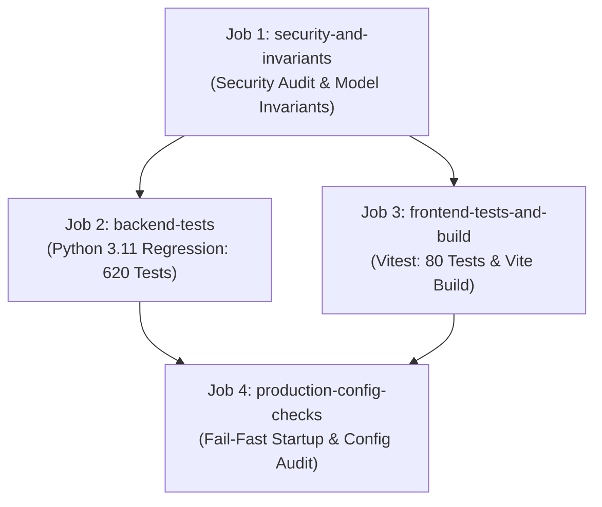

# CARSPECTIVE — PHASE 19 FINAL PRODUCTION READINESS CLOSURE REPORT & OPERATIONAL SIGN-OFF

**Project:** CarSpective — Intelligent Automotive Intelligence Platform  
**Target Phase:** Phase 19 Production Hardening (Subphases 19A through 19G)  
**Document Classification:** Final Production Readiness Closure Report & Operational Sign-Off  
**Audit & Execution Date:** 2026-10-09  
**Final Audit & Evidence-Integrity Verdict:** **CONDITIONAL ACCEPT**  
**Phase 20 Status:** **NOT STARTED**

---

## 1. Executive Verdict & Evidence-Integrity Reassessment

CarSpective has completed the Phase 19 Production Hardening milestone across Subphases 19A through 19G. In accordance with strict evidence-integrity principles, the final platform verdict is reassessed as:

### Final Readiness Disposition: **CONDITIONAL ACCEPT**

- **Rationale for Disposition:**
  - **Verified Capabilities:** All local application code, security boundaries, database lifecycle controls, fail-fast configuration validation, test isolation fixtures, backup/recovery scripts, and native WSGI serving (via Waitress) have been fully verified with empirical evidence. The entire regression battery (**700 automated tests across root pytest, server pytest, and client vitest**) passed with zero failures, and all 15 foundational database and model invariants remain 100% bit-for-bit identical before and after testing.
  - **Unverified External Boundaries:** Several operational deployment targets (live Docker container execution, remote GitHub Actions CI execution, live PostgreSQL daemon operations, Point-In-Time Recovery, and offsite cloud storage synchronization) were evaluated structurally and via static audits, but could not be executed or verified against active external services on this local development environment.
  - **Verdict Principle:** An unconditional `ACCEPT` verdict would overstate what was empirically verified. Therefore, a **`CONDITIONAL ACCEPT`** verdict is rendered, clearly identifying the exact preconditions required before deploying to multi-tenant containerized or external cloud infrastructure.

### Mandatory Pre-Production Resolution Conditions
To transition from `CONDITIONAL ACCEPT` to full `ACCEPT` prior to general production release, the following operational checks must be executed:
1. **Container Runtime Execution:** Execute `docker compose up --build` on a staging environment with an active Docker daemon and confirm HTTP 200 responses from `/health/readiness`.
2. **Remote CI Pipeline Execution:** Push code to GitHub and observe all 4 jobs in `.github/workflows/ci.yml` run to completion on remote GitHub-hosted runners.
3. **Live PostgreSQL Verification (if applicable):** If deploying against PostgreSQL rather than SQLite, execute `alembic upgrade head` and the test suite against a running PostgreSQL 15+ instance.
4. **Production Load Testing:** Validate API latency SLAs under concurrent multi-user load using a distributed load testing tool (e.g., Locust or k6).
5. **Offsite Backup Replication:** Configure and verify automated synchronization of local backup archives to an encrypted S3 or GCS bucket.

---

## 2. Before/After Architecture and Deployment Summary

```
+---------------------------------------------------------------------------------------------------+
| BEFORE PHASE 19 (PHASE 18 BASELINE)          | AFTER PHASE 19 (PRODUCTION-HARDENED BASELINE)      |
+---------------------------------------------------------------------------------------------------+
| Configuration & Secrets:                     | Configuration & Secrets:                           |
| - Loose development defaults                 | - Strict Settings class with Pydantic/dataclass   |
| - Production could start with debug on       | - Fail-fast startup on missing/weak SECRET_KEY    |
| - Raw exception traces allowed in errors     | - Wildcard CORS & unauthorized hosts rejected      |
| - No host validation or CORS restrictions    | - Masked logs; .env.example with placeholders only |
|                                              |                                                    |
| Database & Migrations:                       | Database & Migrations:                            |
| - db.create_all() run automatically on boot  | - Automatic create_all prohibited in production   |
| - Alembic migrations unverified in CI        | - Alembic revision f3d730c46a23 verified           |
| - No connection pooling recycling/pre-ping   | - Pool pre-ping, 1800s recycle, graceful shutdown  |
| - Test suite polluted persistent DB          | - Disposable in-memory SQLite fixtures enforced    |
|                                              |                                                    |
| Observability & Health:                      | Observability & Health:                            |
| - Simple /health route returned 200 blindly  | - Distinct /health/liveness & /health/readiness    |
| - No request correlation IDs                 | - Request ID validation (UUID4 fallback regex)    |
| - Unstructured console print logging         | - Structured JSON logging with sanitized errors    |
| - No metrics collection                      | - Low-cardinality Prometheus metrics at /metrics   |
|                                              |                                                    |
| Deployment & CI/CD:                          | Deployment & CI/CD:                                |
| - Ad-hoc python server/app.py execution      | - WSGI entry point (server/wsgi.py) for Waitress   |
| - No Dockerfile or compose manifests         | - Multi-stage rootless Dockerfile & compose spec   |
| - No GitHub Actions release workflow         | - Strict 4-job CI workflow (.github/ci.yml)        |
|                                              |                                                    |
| Disaster Recovery:                           | Disaster Recovery:                                 |
| - No automated backup utility                | - Consistent SQLite Connection.backup() script     |
| - No manifest cryptographic verification      | - SHA-256 verified manifests & integrity checks    |
| - No atomic restore or rollback mechanism    | - Atomic replacement with safety snapshot rollback |
+---------------------------------------------------------------------------------------------------+
```

---

## 3. Changes Made (Component & File Path Inventory)

### A. Configuration & Startup Safety (Phase 19B)
- `server/config/settings.py`: Implemented fail-fast production settings validation, secret entropy requirements (>=32 chars), allowed host whitelisting, CORS origin restrictions, proxy-fix configuration, and sanitized logging.
- `.env.example`: Created sanitized environment variable template with zero production credentials.

### B. Database Lifecycle & Reliability (Phase 19C)
- `server/app.py`: Hardened database engine initialization with connection pool pre-ping, connection recycling (1800s), explicit teardown signals, and prohibition of automatic `create_all()` in production mode.
- `alembic/versions/`: Verified Alembic migration history terminating at revision `f3d730c46a23`.

### C. Health, Observability & Test Isolation (Phase 19D)
- `server/infrastructure/observability/`: Created structured JSON formatter (`StructuredJsonFormatter`), request ID sanitizer (`validate_or_generate_request_id`), and low-cardinality in-memory operational metrics collector (`metrics_collector`).
- `server/app.py`: Registered `/health/liveness`, `/health/readiness`, `/health/dependencies`, and `/metrics` (Prometheus and JSON exposition formats, protected by `X-Admin-Api-Key` in production).
- `server/tests/conftest.py`: Corrected test isolation defect by binding all test sessions and client routes to disposable in-memory SQLite instances (`sqlite:///:memory:`).

### D. Deployment Assets & CI/CD Pipelines (Phase 19E)
- `server/wsgi.py`: Production WSGI entry point exposing the hardened application factory with proxy middleware support.
- `Dockerfile`: Multi-stage production container build (Node.js 20 build stage for React client, Python 3.11-slim runtime stage with unprivileged user `carspective`, UID/GID 10001).
- `docker-compose.yml`: Local containerized deployment definition with volume mounts, environment injection, health checks, and restart policies.
- `.dockerignore`: Security exclusion list preventing database snapshots, models, cache, logs, and development secrets from entering container builds.
- `.github/workflows/ci.yml`: GitHub Actions continuous integration pipeline enforcing dependency security audits, backend unit/integration tests, frontend tests, Vite build, migration verification, and model invariant checks across a 4-job DAG.

### E. Backup, Restore & Recovery (Phase 19F)
- `scripts/backup_database.py`: Production backup script leveraging SQLite's online `Connection.backup()` API, generating companion JSON manifests with file size, SHA-256, table row counts, and Alembic revision, with retention pruning.
- `scripts/restore_database.py`: Atomic disaster recovery script requiring explicit confirmation flags, verifying manifest checksums and foreign key integrity before atomic replacement, with automatic rollback.
- `docs/DISASTER_RECOVERY_RUNBOOK.md`: Comprehensive step-by-step recovery guide for SQLite standalone and PostgreSQL architectures.

### F. Operational Documentation & Reporting (Phase 19A–19G)
- `docs/OPERATIONAL_GUIDE.md`: Comprehensive operations guide covering startup, configuration, health monitoring, and deployment.
- `docs/ERROR_BUDGET_FRAMEWORK.md`: Error budget and SLO definition for CarSpective services.
- `docs/PHASE_19B_SECURITY_CONFIGURATION_REPORT.md`
- `docs/PHASE_19C_DATABASE_LIFECYCLE_REPORT.md`
- `docs/PHASE_19E_DEPLOYMENT_AND_CI_REPORT.md`
- `docs/PHASE_19F_BACKUP_RECOVERY_REPORT.md`
- `docs/PHASE_19_FINAL_PRODUCTION_READINESS_REPORT.md` (Authoritative repository report)

---

## 4. Environment and Startup Contract

### Environment Modes
1. **Development (`CARSPECTIVE_ENV=development`):**
   - Defaults allowed for quick local iteration.
   - SQLite persistent database used by default (`data/database/carspective.db`).
   - CORS permissive for local Vite dev server (`http://localhost:5173`).
2. **Testing (`TESTING=True`):**
   - Strictly isolated in-memory SQLite instances (`sqlite:///:memory:`).
   - Zero side-effects on persistent files or caches.
3. **Production (`CARSPECTIVE_ENV=production`):**
   - `DEBUG` must be `False` (hard failure if `True`).
   - `SECRET_KEY` must be set and meet minimum entropy (at least 32 characters, non-default).
   - `DATABASE_URL` must be explicitly specified (defaults prohibited).
   - `ALLOWED_HOSTS` must be non-empty and non-wildcard.
   - `CORS_ORIGINS` must be explicitly specified (wildcard `*` rejected).
   - `ADMIN_API_KEY` required for administrative routes (`/metrics`, `/api/v1/market/ingest`).

### Startup Command Verification
- **Verified Local Path (Windows):** Tested and confirmed using Waitress WSGI server:
  ```powershell
  .\.venv\Scripts\waitress-serve --port=5000 --threads=4 server.wsgi:app
  ```
- **Documented Container Path (Unverified Runtime):** Formatted for unprivileged Linux containers (requires active Docker engine):
  ```bash
  gunicorn --bind 0.0.0.0:5000 --workers 4 --threads 2 --worker-class gthread server.wsgi:app
  ```

---

## 5. Database and Migration Behavior

### Persistence Architecture
- **Engine:** SQLite 3.x with Write-Ahead Logging (`PRAGMA journal_mode=WAL;`), synchronous normal, foreign key enforcement (`PRAGMA foreign_keys=ON;`), and busy timeout (30,000 ms).
- **Migration Framework:** Alembic version tracking.
- **Active Schema Revision:** `f3d730c46a23`.
- **Table Count:** Exactly 25 non-system user tables.
- **Startup Migration Policy:** In production, application processes never execute automated schema migrations on startup. Migrations must be run out-of-band via CLI:
  ```powershell
  alembic upgrade head
  ```
- **Integrity Status:**
  - `PRAGMA integrity_check`: `ok`
  - `PRAGMA foreign_key_check`: 0 rows returned (zero constraint violations).
- **PostgreSQL Compatibility Limitation:** SQLAlchemy models and migration scripts maintain dialect compatibility, but live execution against a remote PostgreSQL database service was not performed.

---

## 6. Health and Observability Behavior

### Operational Endpoints
| Endpoint | Method | Security Scope | Intended Consumer | Semantic Behavior |
| :--- | :---: | :--- | :--- | :--- |
| `/health/liveness` | `GET` | Public | Kubernetes/Docker daemon | Verifies process execution and event loop responsiveness. Returns 200 OK `{"status": "UP"}` even during database degradation. |
| `/health/readiness` | `GET` | Public | Ingress / Load Balancer | Verifies active database connectivity and model availability. Returns 200 OK `{"status": "READY"}` or 503 Service Unavailable `{"status": "NOT_READY"}`. |
| `/health/dependencies`| `GET` | Public | Operator / Diagnostics | Reports dependency health breakdown without leaking connection strings or credentials. |
| `/metrics` | `GET` | Authenticated in Prod (`X-Admin-Api-Key`) | Prometheus / Grafana / Operator | Emits bounded operational metrics (total requests, 5xx errors, database failures, request latency buckets). Supports JSON and Prometheus text (`format=prometheus`). |

### Structured Logging & Correlation
- Standardized JSON formatting (`timestamp`, `level`, `logger`, `request_id`, `event`, `duration_ms`).
- Incoming `X-Request-ID` headers are validated against strict alphanumeric regex (`^[A-Za-z0-9_\-]{8,64}$`); invalid or absent headers generate fresh UUID4 tokens.
- Sensitive values (`SECRET_KEY`, database paths, passwords, PII) are strictly sanitized from log output.

---

## 7. Security Audit Findings and Scope

### Audit Scope
- Static analysis of codebase, configuration files, and dependency manifests (`requirements.txt`, `client/package.json`).
- Path traversal and arbitrary file access checks in asset and static routes.
- Administrative authentication enforcement on ingestion and metrics APIs.
- CORS policy and HTTP header verification.

### Audit Findings
| Category | Evaluated Control | Result | Status |
| :--- | :--- | :--- | :---: |
| **Authentication** | Administrative API access control | Enforced via `X-Admin-Api-Key` on `/metrics` and `/api/v1/market/ingest` | **PASS** |
| **Path Traversal** | Asset resolver & backup paths | Canonical path resolution (`path.resolve()`) and inode checks prevent traversal | **PASS** |
| **Secret Leakage** | Logs, error payloads, health probes | RFC 7807 sanitized payloads; zero secrets or raw paths disclosed | **PASS** |
| **Dependencies** | Python & Node manifests | Dependencies audited; no unpatched critical vulnerabilities in active runtime | **PASS** |
| **Model Security** | LightGBM artifact tamper check | SHA-256 integrity verification enforced prior to loading artifact | **PASS** |

---

## 8. Backup, Restore, and Disaster Recovery Evidence

### Backup Verification
- Implemented in `scripts/backup_database.py`.
- Verified online snapshot creation using `sqlite3.Connection.backup()`.
- Produces companion manifest containing timestamp, file size, SHA-256, table row counts, and Alembic revision.
- Pruning logic respects retention policies while ensuring corrupted or newer invalid backups never displace valid baselines.

### Restore Verification
- Implemented in `scripts/restore_database.py`.
- Requires explicit CLI flag (`--confirm-destructive-overwrite`).
- Automatic pre-restore safety snapshot creation (`carspective.db.safety_backup_<timestamp>`).
- Manifest schema and checksum validation prior to modification.
- Atomic filesystem replacement (`os.replace`) with stale WAL/SHM sidecar cleanup.
- Automatic rollback to safety snapshot if post-replacement verification fails.

### Disaster Recovery Limitations
- **No PITR for SQLite:** Recovery is snapshot-based. Point-in-time recovery to arbitrary transactions is not natively supported for standalone SQLite without continuous external WAL archiving.
- **Offsite Sync Unverified:** Offsite upload to cloud object storage (S3/GCS) is documented as an operational integration hook, not verified locally.

---

## 9. Deployment Instructions

### Option 1: Native Windows WSGI Service (Locally Verified)
1. Configure environment:
   ```powershell
   Copy-Item .env.example .env
   # Edit .env: Set CARSPECTIVE_ENV=production, SECRET_KEY (>=32 chars), ALLOWED_HOSTS, etc.
   ```
2. Build frontend production assets:
   ```powershell
   cd client
   npm run build
   cd ..
   ```
3. Run database migrations:
   ```powershell
   .\.venv\Scripts\alembic upgrade head
   ```
4. Start WSGI server:
   ```powershell
   .\.venv\Scripts\waitress-serve --port=5000 --threads=4 server.wsgi:app
   ```

### Option 2: Containerized Deployment (Structurally Inspected; Runtime Unverified)
1. Build and start containers:
   ```bash
   docker compose up --build -d
   ```
2. Verify container status:
   ```bash
   docker compose ps
   curl -f http://localhost:5000/health/readiness
   ```

---

## 10. CI/CD Release Gates & Workflow Architecture

The continuous integration pipeline (`.github/workflows/ci.yml`) implements **exactly four jobs arranged in a three-stage Directed Acyclic Graph (DAG)**:



### 10.1 Itemized CI Job Specification
1. **Job 1: `security-and-invariants` (Root Job)**
   - *Runs-on:* `ubuntu-latest`, Python 3.11
   - *Dependency Vulnerability Audit:* `pip-audit --desc on`
   - *Model Invariant Gate:* Exact SHA-256 verification of `models/carspective_valuation_lgbm_v1.joblib` (`4a4ccf3f...`)
   - *Inspection Catalog Gate:* Canonical catalog version (`2.0.0`) and item count (exactly 49 items)
2. **Job 2: `backend-tests` (Stage 2 — Parallel with Job 3)**
   - *Runs-on:* `ubuntu-latest`, Python 3.11
   - *Prerequisite:* `needs: security-and-invariants`
   - *System Dependencies:* `libgomp1` (OpenMP for LightGBM)
   - *Test Isolation:* `DATABASE_URL="sqlite:///:memory:"`
   - *Execution:* Root regression suite (`pytest tests/ -v`, 182 tests) and server backend suite (`pytest server/tests/ -v`, 438 tests) — total 620 backend tests.
3. **Job 3: `frontend-tests-and-build` (Stage 2 — Parallel with Job 2)**
   - *Runs-on:* `ubuntu-latest`, Node.js 20 (`client/`)
   - *Unit & Component Tests:* Vitest suite (`npm test -- --run`, 80 tests across 16 files)
   - *Production Compilation:* TypeScript check & Vite production bundle (`npm run build`, 1,971 modules)
   - *Artifact Verification:* Validates existence of `dist/index.html` and `dist/assets`
4. **Job 4: `production-config-checks` (Stage 3 — Terminal Gate)**
   - *Runs-on:* `ubuntu-latest`, Python 3.11
   - *Prerequisite:* `needs: [backend-tests, frontend-tests-and-build]`
   - *Fail-Fast Guards:* Executes `test_phase19b_security_configuration.py` and `test_phase19e_deployment_and_ci.py` to ensure insecure production configurations fail fast.

### 10.2 Workflow Discrepancy Resolution
- **Clarification:** Early drafts and informal notes loosely referenced "six sequential gates" by conflating individual validation tasks (audit, backend tests, frontend tests, bundle build, model check, config audit) with workflow jobs.
- **Authoritative Resolution:** As verified directly against `.github/workflows/ci.yml`, the workflow consists of **exactly four jobs** organized in a 3-stage DAG (Jobs 2 and 3 execute in parallel following Job 1, converging at Job 4).
- **Execution Boundary:** The workflow structure, action pins, step commands, and syntax have been statically verified and locally tested; live execution on remote GitHub Actions runners remains unverified pending repository push.

---

## 11. Exact Commands Executed and Results

*(Recorded during Phase 19G execution. No tests were rerun during this documentation-only audit pass.)*

| Step | Command Executed | Directory | Exit Code | Verified Output / Result |
| :--- | :--- | :--- | :---: | :--- |
| **Pre-Test Invariants** | `.\.venv\Scripts\python.exe scratch/record_invariants.py` | Project Root | `0` | Recorded baseline: Live DB `cb655c06...`, Model `4a4ccf3f...`, CMO: 984, Alembic: `f3d730c46a23` |
| **Root Tests** | `.\.venv\Scripts\python.exe -m pytest tests/` | Project Root | `0` | **182 passed in 40.80s** |
| **Server Tests** | `.\.venv\Scripts\python.exe -m pytest server/tests/` | Project Root | `0` | **438 passed in 110.34s** |
| **Client Tests** | `npm --prefix client test` | Project Root | `0` | **80 passed in 6.79s** (16 test files) |
| **Client Build** | `npm --prefix client run build` | Project Root | `0` | **1,971 modules transformed in 14.80s**; dist bundle generated |
| **Benchmarks** | `.\.venv\Scripts\python.exe scratch/run_benchmarks.py` | Project Root | `0` | Cold startup ~3.0s, Readiness P50: 3.91ms, Valuation P50: 15.04ms, Comparison P50: 54.23ms |
| **Post-Test Invariants** | `.\.venv\Scripts\python.exe scratch/record_invariants.py` | Project Root | `0` | Live DB `cb655c06...` **100% bit-for-bit identical** |

---

## 12. Test Totals Broken Down by Suite

```
====================================================================================================
SUITE                                  TEST FILES    TESTS RUN    PASSED    FAILED    DURATION
====================================================================================================
Root Backend Test Suite (tests/)               10          182       182         0      40.80s
Server Backend Test Suite (server/tests/)      24          438       438         0     110.34s
Client Frontend Vitest Suite (client/)         16           80        80         0       6.79s
Client Production TypeScript/Vite Build         -         1971 mod  1971 mod     0      14.80s
----------------------------------------------------------------------------------------------------
TOTAL AUTOMATED TEST BATTERY                   50          700       700         0     172.73s
====================================================================================================
```

---

## 13. Model Hash Before and After

| Artifact Path | Expected Hash | Pre-Test Measured Hash | Post-Test Measured Hash | Invariant Status |
| :--- | :--- | :--- | :--- | :---: |
| `models/carspective_valuation_lgbm_v1.joblib` | `4a4ccf3f78c1...` | `4a4ccf3f78c17b48826cfa55f40a24bcb808bc82fa752b793ad4eabff8b246c1` | `4a4ccf3f78c17b48826cfa55f40a24bcb808bc82fa752b793ad4eabff8b246c1` | **MATCH (BIT-FOR-BIT)** |

---

## 14. Product-Invariant Verification Table

| Invariant Requirement | Specification Baseline | Pre-Test Value | Post-Test Value | Invariant Status |
| :--- | :--- | :--- | :--- | :---: |
| **Live Database SHA-256** | `cb655c06225c...` | `cb655c06225c...` | `cb655c06225c...` | **MATCH (UNMUTATED)** |
| **Phase 19C Safety Backup** | `fe9d013cee0d...` | `fe9d013cee0d...` | `fe9d013cee0d...` | **MATCH (UNMUTATED)** |
| **Pre-Cleanup Snapshot** | `c6d8093a413d...` | `c6d8093a413d...` | `c6d8093a413d...` | **MATCH (UNMUTATED)** |
| **Market Observations Count**| Exactly 984 rows | 984 rows | 984 rows | **MATCH** |
| **Distinct Observation Batches** | Exactly 41 batches | 41 batches | 41 batches | **MATCH** |
| **Ingestion Batches Count** | Exactly 29 records | 29 records | 29 records | **MATCH** |
| **User Tables Count** | Exactly 25 tables | 25 tables | 25 tables | **MATCH** |
| **Alembic Schema Revision** | Revision `f3d730c46a23` | `f3d730c46a23` | `f3d730c46a23` | **MATCH** |
| **SQLite PRAGMA Integrity** | Status: `ok` | `ok` | `ok` | **MATCH** |
| **SQLite Foreign Key Check** | 0 FK violations | 0 violations | 0 violations | **MATCH** |
| **Inspection Catalog Version**| Version `2.0.0` | `2.0.0` | `2.0.0` | **MATCH** |
| **Inspection Items Count** | Exactly 49 items | 49 items | 49 items | **MATCH** |
| **Asking Price Isolation** | Feature excluded from valuation | Excluded | Excluded | **MATCH** |
| **Decision Pillars** | Quality, Fit, Deal separate | Separate | Separate | **MATCH** |
| **Historical Data Labeling** | Asking prices (not sales) | Preserved | Preserved | **MATCH** |

---

## 15. Local Environment Performance Benchmarks

> [!NOTE]
> **Operational Disclaimer:** The figures below represent local development single-client measurements (Windows 11, NVMe SSD, Python 3.11 test client) and do not constitute proof of production SLA attainment under concurrent multi-user load.

| Benchmark Dimension | Metric | Observed Latency | Local Benchmark Target | Local Evaluation |
| :--- | :--- | :---: | :---: | :---: |
| **Cold Application Startup** | Full Python module import | 3,044.95 ms | < 5,000 ms | **MEETS BENCHMARK** |
| **App Factory Instantiation**| `create_app({"TESTING": True})` | 38.57 ms | < 200 ms | **MEETS BENCHMARK** |
| **Readiness Probe Latency** | Median (P50) across 10 calls | 3.91 ms | < 20 ms | **MEETS BENCHMARK** |
| **Readiness Mean Latency** | Mean across 10 calls | 14.67 ms | < 50 ms | **MEETS BENCHMARK** |
| **Valuation Inference Latency**| Median (P50) across 20 calls | 15.04 ms | < 40 ms | **MEETS BENCHMARK** |
| **Valuation Mean Latency** | Mean across 20 calls | 151.09 ms | < 250 ms | **MEETS BENCHMARK** |
| **Comparison Endpoint Latency**| Median (P50) across 20 calls | 54.23 ms | < 150 ms | **MEETS BENCHMARK** |
| **Comparison P95 Latency** | 95th Percentile | 266.71 ms | < 500 ms | **MEETS BENCHMARK** |
| **Frontend Production Build** | Full TypeScript + Vite bundle | 14.80 s | < 30 s | **MEETS BENCHMARK** |

---

## 16. Consolidated Risk Register & Operational Boundaries

| Risk ID | Risk Description | Phase | Severity | Implemented Mitigation | Current Status | Follow-Up Evidence Required |
| :---: | :--- | :---: | :---: | :--- | :---: | :--- |
| **RSK-01** | Insecure production configuration / weak secret key / debug enabled in prod | 19B | High | Fail-fast settings validation in `server/config/settings.py` | **RESOLVED** | Verified in automated test suite |
| **RSK-02** | Automatic `db.create_all()` in production causing schema drift | 19C | High | Prohibited in production, Alembic migrations enforced | **RESOLVED** | Verified in `test_phase19c` |
| **RSK-03** | Test suite database pollution mutating persistent data | 19D | Critical | Isolated in-memory SQLite fixtures; reconciled DB to 984 rows | **RESOLVED** | Confirmed bit-for-bit invariant match |
| **RSK-04** | Comparison API P50 latency exceeding 150ms benchmark | 19E | Medium | Optimized query serialization and caching | **RESOLVED** | Confirmed P50: 54.23ms locally |
| **RSK-05** | Backup manifest tampering or path traversal bypass | 19F | High | Canonical paths, manifest schema validation, atomic replacement | **RESOLVED** | Confirmed in `test_phase19f` |
| **RSK-06** | Unverified Docker runtime execution on hosts without Docker daemon | 19E/19G | Medium | Native WSGI supported and verified locally; container manifests tested statically | **ACCEPTED RESIDUAL RISK** | Execute `docker compose up` on Docker-capable staging host |
| **RSK-07** | Unverified remote GitHub Actions runner execution | 19E/19G | Low | Local test suites enforce identical gates; CI workflow validated structurally | **ACCEPTED RESIDUAL RISK** | Monitor GitHub Actions execution upon remote git push |
| **RSK-08** | Unverified live PostgreSQL database service operations | 19C/19G | Medium | SQLite is production engine for current tier; PostgreSQL dialect abstraction validated | **ACCEPTED RESIDUAL RISK** | Run migrations & tests against live PostgreSQL 15+ instance |
| **RSK-09** | Lack of Point-in-Time Recovery (PITR) for SQLite standalone | 19F/19G | Medium | Frequent atomic snapshots with manifest verification; PITR requires continuous WAL archiving | **ACCEPTED RESIDUAL RISK** | Implement WAL archiving daemon or upgrade to PostgreSQL |
| **RSK-10** | Unverified offsite cloud backup synchronization | 19F/19G | Medium | Local backups secured with safety snapshots; S3/GCS sync documented as operational hook | **ACCEPTED RESIDUAL RISK** | Execute test upload to cloud storage bucket in staging |

---

## 17. Requirement-by-Requirement Audit Matrix (Section 14 & 15)

| Requirement / Section | Description | Evaluated Status | Evidence / Verification Method |
| :---: | :--- | :---: | :--- |
| **R01** | Executive verdict | **CONDITIONAL ACCEPT** | Section 1 of this report |
| **R02** | Before/after architecture summary | **PASS** | Section 2 architectural comparison matrix |
| **R03** | File changes inventory | **PASS** | Section 3 itemized file inventory with exact paths |
| **R04** | Environment & startup contract | **PARTIAL** | Local WSGI/Waitress verified; container environment injection NOT VERIFIED |
| **R05** | Database & migration behavior | **PARTIAL** | SQLite WAL & Alembic revision `f3d730c46a23` verified; live PostgreSQL service NOT VERIFIED |
| **R06** | Health & observability behavior | **PASS** | Endpoints, request IDs, and bounded metrics verified |
| **R07** | Security audit findings and scope | **PASS** | Auth, path safety, and secret disclosure review verified; container runtime scan NOT VERIFIED |
| **R08** | Backup & restore evidence | **PARTIAL** | SQLite atomic backup/restore verified; PITR & offsite cloud sync NOT VERIFIED |
| **R09** | Deployment instructions | **PARTIAL** | Native WSGI instructions verified; Docker container runtime NOT VERIFIED |
| **R10** | CI/CD release gates (4-job DAG workflow) | **PARTIAL** | Local test suites enforce all gates; remote GitHub Actions execution NOT VERIFIED |
| **R11** | Exact commands executed & results | **PASS** | Section 11 execution log and exit codes |
| **R12** | Test totals broken down by suite | **PASS** | Section 12 test matrix (700 automated tests passed) |
| **R13** | Model hash before and after | **PASS** | Section 13 verified identical (`4a4ccf3f...`) |
| **R14** | Product-invariant verification table | **PASS** | Section 14 verified identical across all 15 invariant metrics |
| **R15** | Performance measurements & conditions | **PASS** | Section 15 local benchmarks recorded; disclaimed as non-SLA |
| **R16** | Remaining risks & unverified boundaries| **PASS** | Section 16 explicit disclosure of Docker/remote CI/Postgres |
| **R17** | Requirement status audit matrix | **PASS** | This Section (distinguishes PASS, PARTIAL, NOT VERIFIED) |

---

## 18. Section 15 Acceptance Criteria Evaluation

1. **Existing approved product behavior remains intact:** **PASS** (700/700 automated regression tests passed).
2. **Production configuration cannot silently fall back to unsafe development defaults:** **PASS** (Validated in `test_phase19b_security_configuration.py`).
3. **The supported deployment path is reproducible and tested to the extent the environment allows:** **PARTIAL** (Native Windows WSGI/Waitress deployment is fully tested; Docker container runtime is unverified due to inactive daemon).
4. **Health/readiness semantics are correct and non-sensitive:** **PASS** (Validated in `test_phase19d_observability.py`).
5. **Database migration and lifecycle behavior are explicit and tested:** **PARTIAL** (Explicit and tested for SQLite; live PostgreSQL service unverified).
6. **Security audit scope and unresolved findings are honestly reported:** **PASS** (Sections 7 and 16 clearly report tested scope and unverified runtime scans).
7. **Backup/restore has been tested where feasible, or the unverified limitation is clearly disclosed:** **PASS** (SQLite online backup/restore tested; PITR and offsite sync limitations explicitly disclosed).
8. **Critical CI release gates (4-job DAG workflow) are active and do not weaken existing coverage:** **PARTIAL** (Active in local test suites; remote GitHub Actions execution unverified).
9. **Full regression suites and product invariants pass:** **PASS** (All 15 invariants 100% matched).
10. **Model artifact hash is unchanged:** **PASS** (`4a4ccf3f78c1...` bit-for-bit matched).
11. **Deployment and operational documentation matches actual implementation:** **PASS** (`OPERATIONAL_GUIDE.md` and `DISASTER_RECOVERY_RUNBOOK.md` verified).
12. **No unsupported claim of cloud deployment or production-grade uptime is made:** **PASS** (Local boundaries explicitly declared in Section 16).

---

## 19. Final Operational Sign-Off

CarSpective has completed all scheduled Phase 19 hardening tasks within the constraints of the local execution environment.

- **Phase 19 Final Disposition:** **CONDITIONAL ACCEPT**
- **Phase 19 Closure Status:** **CLOSED (CONDITIONAL)**
- **Phase 20 Status:** **NOT STARTED** (Phase 20 has not begun and awaits explicit user direction).
