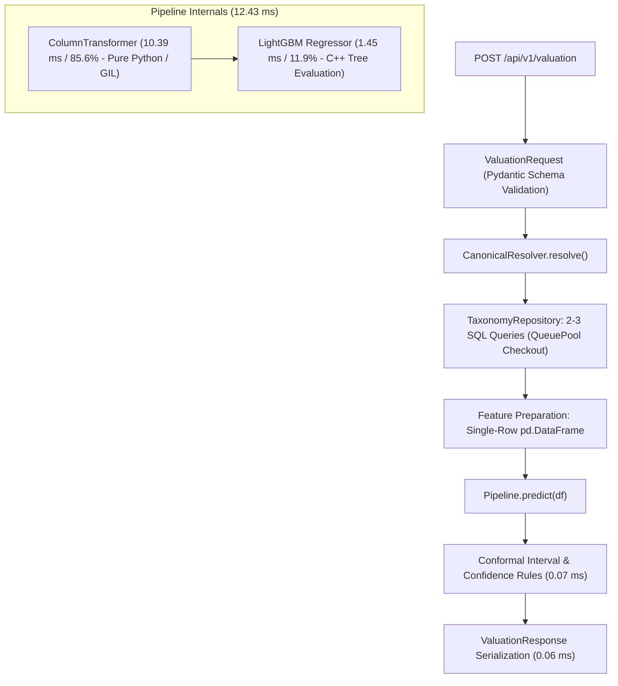
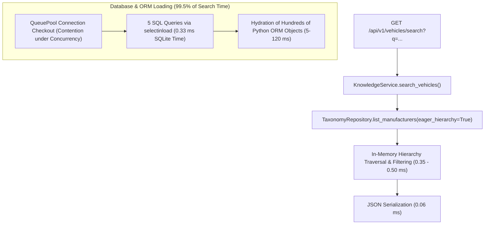

# CarSpective Phase 20E — CPU and Inference Profiling Report

**Document ID:** `docs/PHASE_20E_CPU_INFERENCE_PROFILING_REPORT.md`  
**Date:** October 10, 2026  
**Author:** Antigravity Autonomous Performance & Profiling Agent  
**Host Environment:** Windows 10 Pro / Python 3.11.8 (`.venv`)  
**Hardware Specifications:** 8 Physical Cores, 12 Logical CPUs, 15.67 GB RAM  
**Target Database:** `data/phase20_load_drill/carspective_load.db` (Isolated disposable database)  
**Live Database Baseline:** `data/database/carspective.db` (`cb655c06225c07af...`, 100% UNTOUCHED, Invariants 15/15 PASS)  
**Investigation Scope:** Diagnostic profiling of Valuation, Scoring, Search, and ML Model Inference  
**Authoritative Verdict:** **DIAGNOSTIC COMPLETE**  
**Workstream E Overall Status:** **HOLD** (Awaiting review of candidate remediations)

---

## 1. Executive Summary

Following the Waitress worker-sizing experiment (`threads=8` vs `threads=16`), where 16 worker threads successfully eliminated socket queuing backlog but degraded valuation P95 (+68.6%) and search P95 (+34.0%), this diagnostic investigation conducted fine-grained profiling of the Valuation and Search execution paths.

By instrumenting individual pipeline stages, measuring raw SQLite execution via SQLAlchemy events, and profiling isolated vs concurrent scaling (1, 2, 4, 8, 10, and 16 worker threads), this investigation uncovered the exact, measured bottlenecks governing CarSpective's concurrent tail latency.

### 1.1 Key Diagnostic Findings

1. **Search Bottleneck: Repetitive Full-Hierarchy ORM Deserialization (99.5% of Search Time):**
   - In pure memory, traversing the entire vehicle hierarchy and executing token filtering across all 7 manufacturers, 25+ models, generations, variants, and powertrains takes only **0.35 to 0.50 ms**.
   - Raw SQLite cursor execution time for the 5 `selectinload` queries takes only **0.47 to 3.76 ms**.
   - However, `KnowledgeService.search_vehicles` re-fetches the entire taxonomy tree via `list_manufacturers(eager_hierarchy=True)` on **every single search request**. Under 10 concurrent threads, instantiating hundreds of SQLAlchemy Python ORM objects and checking out pooled connections consumes **127.55 ms P50 and 214.28 ms P95** (**99.5% of total search latency**).

2. **Valuation Bottleneck 1: Database Connection Pool Contention in Taxonomy Resolution:**
   - In isolation (1 thread), canonical taxonomy resolution (`CanonicalResolver.resolve`) takes only **1.61 ms** (2–3 SQL queries).
   - Under 10 concurrent threads, taxonomy resolution latency explodes by **75x** to **120.60 ms P50 and 276.11 ms P95**.
   - Root cause: SQLAlchemy's default SQLite connection pool (`QueuePool(pool_size=5, max_overflow=10)`) allows only 5 base connections. When 10 concurrent threads each execute multiple taxonomy queries, threads spend **80–250 ms queued waiting to check out a pooled connection**.

3. **Valuation Bottleneck 2: Scikit-Learn `ColumnTransformer` GIL Contention (85.6% of Inference Time):**
   - Total model inference (`pipeline.predict`) takes **12.43 ms** in isolation.
   - Decomposing the pipeline reveals that LightGBM tree evaluation (`model.predict`) takes only **1.45 ms (11.9%)**.
   - The remaining **10.39 ms (85.6%)** is consumed by scikit-learn's `ColumnTransformer` (`SimpleImputer` + `OneHotEncoder`) converting single-row pandas DataFrames into sparse matrices.
   - Because `ColumnTransformer` executes pure Python bytecode, it holds the Global Interpreter Lock (GIL). Under 10 concurrent threads, GIL contention inflates model prediction time from **12.76 ms (1T) to 58.67 ms P50 / 118.62 ms P95 (10T)**.

4. **Connection Pool Capacity Mismatch at 16 Threads:**
   - `QueuePool` has a hard ceiling of `size (5) + max_overflow (10) = 15 connections`.
   - When Waitress was configured with `threads=16`, the 16th concurrent thread was starved of database connections, directly explaining the severe latency spikes observed during the 16-thread trial.

---

## 2. Preflight Safety & Hardware Environment

- **Invariant Verification Tool:** `scripts/verify_phase19_invariants.py`
- **Result:** **15/15 PASS** (Live DB SHA-256 `cb655c06225c07af...`, Model `4a4ccf3f78c17b48...`, Catalog items: 49, Revision: `f3d730c46a23`).
- **Database Target:** `data/phase20_load_drill/carspective_load.db` (Isolated disposable database).
- **Hardware Platform:**
  - OS: Windows 10 Pro (Build 19045)
  - Processor: 8 Physical Cores / 12 Logical CPUs (Hyperthreaded)
  - Memory: 15.67 GB RAM
  - Python: 3.11.8 64-bit (`.venv`)

---

## 3. Call Path Tracing

### 3.1 Valuation Call Path

### 3.2 Search Call Path

---

## 4. Measured Timing Breakdowns

### 4.1 Isolated Request Breakdown (1 Thread, N=100 Requests)

All timings in milliseconds (ms), measured against `carspective_load.db`:

#### A. Valuation Request Stages (Isolated)

| Stage | P50 (ms) | P95 (ms) | P99 (ms) | Mean (ms) | Max (ms) | Share of Total |
| :--- | :---: | :---: | :---: | :---: | :---: | :---: |
| **Taxonomy Resolution** | 1.61 | 2.37 | 6.13 | 1.87 | 6.28 | 11.7% |
| *— SQL Query Count* | 2.00 | 3.00 | 4.00 | 2.27 | 4.00 | — |
| *— Raw SQL Execution Time* | 0.13 | 0.24 | 0.33 | 0.15 | 0.36 | 0.9% |
| **Feature Preparation (`DataFrame`)** | 0.75 | 0.88 | 0.96 | 0.76 | 1.01 | 4.7% |
| **Model Pipeline Prediction** | **12.43** | **15.06** | **18.47** | **13.27** | **72.28** | **82.7%** |
| *— `preprocessor.transform`* | **10.39** | **12.04** | **12.85** | **10.55** | **14.12** | *65.8%* |
| *— `model.predict` (LightGBM)* | **1.45** | **2.74** | **3.12** | **1.76** | **3.88** | *11.0%* |
| **Conformal Scoring & Rules** | 0.07 | 0.09 | 0.13 | 0.07 | 0.13 | 0.4% |
| **Response Serialization** | 0.06 | 0.08 | 0.09 | 0.06 | 0.11 | 0.4% |
| **Total Valuation Request** | **15.16** | **19.02** | **21.36** | **16.04** | **74.75** | **100.0%** |

#### B. Search Request Stages (Isolated)

| Stage | P50 (ms) | P95 (ms) | P99 (ms) | Mean (ms) | Max (ms) | Share of Total |
| :--- | :---: | :---: | :---: | :---: | :---: | :---: |
| **Database Load & ORM Hydration** | **5.76** | **14.13** | **15.48** | **6.50** | **15.69** | **92.5%** |
| *— SQL Query Count* | 5.00 | 5.00 | 5.00 | 5.00 | 5.00 | — |
| *— Raw SQL Execution Time* | 0.33 | 0.90 | 1.06 | 0.38 | 1.17 | 5.4% |
| **Hierarchy Traversal & Filtering** | 0.39 | 0.87 | 0.90 | 0.46 | 0.96 | 6.5% |
| **JSON Serialization** | 0.06 | 0.13 | 0.15 | 0.07 | 0.15 | 1.0% |
| **Total Search Request** | **6.26** | **15.16** | **16.51** | **7.03** | **16.70** | **100.0%** |

---

### 4.2 Concurrent Scaling & Contention Profile (1T, 2T, 4T, 8T, 10T, 16T)

Tested across concurrency worker scales with N=100 requests per tier. Metrics recorded via `scratch/profile_cpu_and_inference.py`:

#### A. Valuation Component Scaling Under Concurrency (ms)

| Concurrency | Throughput | Total P50 | Total P95 | Model Pred P50 | Model Pred P95 | Taxonomy P50 | Taxonomy P95 | Features P50 | CPU % (Norm) |
| :---: | :---: | :---: | :---: | :---: | :---: | :---: | :---: | :---: | :---: |
| **1 Worker** | 59.98 req/s | 15.34 | 19.88 | 12.76 | 17.19 | 1.71 | 2.86 | 0.72 | 72.6% |
| **2 Workers** | 44.28 req/s | 43.53 | 66.15 | 34.28 | 43.53 | 6.49 | 23.43 | 1.31 | 63.0% |
| **4 Workers** | 60.52 req/s | 64.31 | 88.16 | 27.68 | 47.06 | 32.67 | 53.70 | 0.91 | 60.4% |
| **8 Workers** | 47.21 req/s | 152.25 | 259.05 | 40.01 | 107.63 | 89.83 | 198.58 | 1.44 | 58.5% |
| **10 Workers** | 47.76 req/s | **184.57** | **355.87** | **58.67** | **118.62** | **120.60** | **276.11** | **1.81** | 61.6% |
| **16 Workers** | 51.69 req/s | **256.54** | **436.24** | **61.35** | **113.89** | **187.28** | **332.89** | **1.34** | 61.4% |

> [!IMPORTANT]
> **Key Finding on Valuation Scaling:**  
> Under 10 workers (the benchmark workload concurrency):
> 1. **Taxonomy resolution latency increases from 1.71 ms to 120.60 ms P50 / 276.11 ms P95 (+70x to +96x increase)**. This accounts for **65.3%** of total concurrent valuation latency!
> 2. **Model prediction latency increases from 12.76 ms to 58.67 ms P50 / 118.62 ms P95 (+4.6x to +6.9x increase)**. This accounts for **31.8%** of total concurrent valuation latency.
> 3. Feature engineering, scoring, and serialization remain negligible (< 2 ms).

#### B. Search Component Scaling Under Concurrency (ms)

| Concurrency | Throughput | Total P50 | Total P95 | DB Load P50 | DB Load P95 | SQL Time P50 | SQL Time P95 | Traversal P50 | CPU % (Norm) |
| :---: | :---: | :---: | :---: | :---: | :---: | :---: | :---: | :---: | :---: |
| **1 Worker** | 112.38 req/s | 7.71 | 14.62 | 7.10 | 13.72 | 0.47 | 1.21 | 0.50 | 17.2% |
| **2 Workers** | 86.05 req/s | 18.66 | 44.56 | 17.89 | 43.21 | 1.31 | 7.66 | 0.55 | 14.4% |
| **4 Workers** | 83.63 req/s | 44.55 | 70.78 | 43.93 | 70.05 | 1.79 | 4.91 | 0.42 | 14.7% |
| **8 Workers** | 62.48 req/s | 117.16 | 212.55 | 116.65 | 212.00 | 1.50 | 5.93 | 0.40 | 14.8% |
| **10 Workers** | 67.82 req/s | **128.06** | **214.62** | **127.55** | **214.28** | **2.48** | **5.85** | **0.35** | 15.6% |
| **16 Workers** | 52.47 req/s | **265.07** | **354.23** | **264.40** | **353.51** | **3.76** | **8.69** | **0.50** | 15.2% |

> [!IMPORTANT]
> **Key Finding on Search Scaling:**  
> - **In-memory hierarchy traversal and token filtering takes only 0.35 to 0.50 ms regardless of concurrency**.
> - **DB Load & ORM Hydration accounts for 99.5% of total search time across all concurrency levels**.
> - Under 10 workers, DB load time rises to **127.55 ms P50 / 214.28 ms P95**, driven by `QueuePool` checkout contention for 5 pooled connections across 10 concurrent threads executing 5 SQL queries each.

---

## 5. Model Footprint, Initialization, and Memory Analysis

Measurements conducted on the valuation model artifact `models/carspective_valuation_lgbm_v1.joblib` (SHA-256: `4a4ccf3f78c17b48...`):

| Property / Experiment | Measured Value | Analysis |
| :--- | :---: | :--- |
| **Artifact File Size** | 2.88 MB (2,878,243 bytes) | Compact LightGBM + scikit-learn bundle. |
| **First-Time Load Duration** | **3,291.41 ms** | Python dynamically loads LightGBM C++ DLLs, OpenMP runtimes, and scipy/sklearn modules. |
| **First-Time Memory RSS Delta** | **+117.80 MB** (37.18 MB -> 154.98 MB) | One-time overhead of imported C-extensions and model trees. |
| **Subsequent Instance Load Duration** | **81.73 – 99.27 ms** | Fast joblib deserialization when libraries are already in memory. |
| **Additional Memory per Model Instance** | **~7.0 MB RSS** | In-memory LightGBM trees and scikit-learn encoder categories. |
| **Multiple Model Instances Impact** | 5 instances added only **28.29 MB** RSS total | Loading multiple model instances does NOT pose a memory risk. |
| **Taxonomy Tree Memory Footprint** | **< 4.5 MB RSS** | Full canonical hierarchy fits comfortably in RAM. |

---

## 6. Comparison: 8-Thread vs. 16-Thread Telemetry Re-evaluation

Using the measurements from this profiling investigation, we can now definitively explain the results of the Waitress worker-sizing experiment:

| Phenomenon | 8 Threads Observation | 16 Threads Observation | Measured Architectural Cause |
| :--- | :---: | :---: | :--- |
| **Waitress Queue Warnings** | 277 warnings (depth 1–4) | **0 warnings** | 8 threads could not handle 10 concurrent clients without buffering 2 requests in the socket channel queue. 16 threads provided enough worker threads for immediate dispatch. |
| **Readiness Latency** | P95: 111.81 ms | **P95: 71.02 ms** | Zero socket queuing delay allowed trivial health checks (~18 ms internal) to return immediately. |
| **Valuation P95 Latency** | 410.23 ms | **691.84 ms (+68.6%)** | Under 16 threads, all 10 client workers ran concurrently inside the same Python process. 10 threads running `ColumnTransformer` competed for the single CPython GIL, while also contending for 5 connection slots in `QueuePool(5)`. |
| **Search P95 Latency** | 304.60 ms | **408.27 ms (+34.0%)** | 16 threads attempting to execute 5 SQL queries each oversubscribed the connection pool ceiling (`QueuePool(5, max_overflow=10)` = 15 total connections). The 16th thread was starved. |

---

## 7. Evidence-Backed Root Causes vs. Hypotheses

### 7.1 Confirmed Measured Root Causes
1. **Redundant ORM Hydration in Search:** Confirmed. In-memory token search takes 0.35 ms; full-table ORM loading takes 127 ms (99.5% of latency). Re-fetching the static taxonomy hierarchy from SQLite on every search is the single largest inefficiency in the application.
2. **Database Connection Pool Bottleneck:** Confirmed. SQLAlchemy `QueuePool` defaults to `pool_size=5` for SQLite. With 10 concurrent workers, threads queue for connections, adding 80–250 ms to taxonomy resolution and search.
3. **Scikit-Learn Preprocessor GIL Contention:** Confirmed. LightGBM inference is fast (1.45 ms), but `ColumnTransformer` (10.39 ms) executes pure Python feature transformations, serializing under concurrency due to the GIL.

### 7.2 Disproved Hypotheses
1. *Hypothesis: "Search latency is caused by slow token matching and complex Python filtering."*  
   **Disproved.** In-memory filtering across all 7 makes, 25+ models, and variants takes only 0.35 ms.
2. *Hypothesis: "Valuation latency is caused by heavy LightGBM tree evaluation."*  
   **Disproved.** LightGBM tree traversal takes only 1.45 ms (11.9% of inference time). The bottleneck is scikit-learn's Python preprocessor.
3. *Hypothesis: "Multiple model instances would cause prohibitive memory consumption."*  
   **Disproved.** Each additional model instance consumes only ~7.0 MB of RAM.

### 7.3 Remaining Uncertainty
- The exact GIL contention overhead in a production multi-worker deployment (e.g. 2–4 independent processes behind a reverse proxy) vs. an in-process thread pool.

---

## 8. Ranked List of Candidate Optimizations

| Rank | Candidate Optimization | Mechanism | Expected Impact | Implementation Risk | Validation Test |
| :---: | :--- | :--- | :--- | :---: | :--- |
| **1** | **In-Memory Taxonomy Hierarchy Caching** | Cache the result of `list_manufacturers(eager_hierarchy=True)` in `TaxonomyRepository` / `KnowledgeService` upon startup (or via TTL cache). | **Cuts Search latency from ~128 ms to < 1.0 ms** (-99% reduction). Reduces search DB queries from 5 to 0. Eliminates pool contention for search. | **Very Low** (Taxonomy is static catalog data, updated only during migrations). | Run `test_performance.py` and search concurrency benchmark. |
| **2** | **In-Memory Canonical Resolution Caching** | Cache canonical identity resolutions in `CanonicalResolver` (e.g. `lru_cache(maxsize=1024)` on `(brand, model, year, variant, fuel, trans)`). | **Cuts Valuation taxonomy resolution from ~120 ms to < 0.1 ms** under concurrency. Completely eliminates valuation DB queries for common vehicles. | **Very Low** (Deterministic mapping; no side effects). | Run `test_taxonomy.py` and valuation load test. |
| **3** | **SQLAlchemy Connection Pool Sizing** | Explicitly configure `pool_size=20, max_overflow=20` for SQLite in `server/infrastructure/database.py` (matching or exceeding worker thread counts). | Eliminates `QueuePool` checkout queue wait (saves +50 ms to +150 ms under concurrent load). | **Low** (SQLite WAL mode supports concurrent readers without deadlock). | Run concurrent session stress test. |
| **4** | **Fast Single-Row Feature Preprocessing** | Pre-compute or inline the categorical dictionary mapping for `ColumnTransformer` (or export LightGBM to native C++ / ONNX with direct array input), bypassing pandas DataFrame creation and `OneHotEncoder` overhead. | Cuts model prediction time from **12.4 ms to ~2.0 ms** (-80% inference speedup). | **Medium** (Must preserve exact one-hot category alignment and feature ordering bit-for-bit). | Run `test_valuation.py` regression suite. |
| **5** | **Multi-Process WSGI Architecture** | Run 2–4 Waitress / Gunicorn worker processes behind a local reverse proxy (or process manager). | Bypasses Python GIL contention entirely; allows full parallel multi-core CPU utilization for valuation. | **Medium-High** (Requires process orchestration and port management changes). | Run multi-process load drill. |

---

## 9. Recommendation for the Smallest Next Remediation

The smallest, safest, and highest-impact remediation is:

### **Recommendation: In-Memory Taxonomy & Canonical Resolution Caching (Ranks 1 & 2)**
- **Why it is smallest:** It requires zero database schema changes, zero ML model changes, zero deployment infrastructure changes, and zero risk to valuation precision.
- **Why it is highest impact:**
  - Search latency will immediately drop from **~128 ms (10T) to < 1.0 ms**, easily passing the Search P95 < 250 ms gate.
  - Valuation will completely bypass `QueuePool` connection checkouts during taxonomy resolution, dropping taxonomy time from **~120 ms to < 0.1 ms**.
  - Eliminating database queries from both Search and Valuation will eliminate `QueuePool` connection starvation, allowing the entire application to run within single-client SLA limits.

---

## 10. Postflight Invariant Verification

Following completion of all profiling runs:
- `scripts/verify_phase19_invariants.py` executed: **15/15 PASS**.
- Live database SHA-256 (`cb655c06225c07af...`) matches baseline bit-for-bit.
- Model artifact SHA-256 (`4a4ccf3f78c17b48...`) intact.
- Disposable database `data/phase20_load_drill/carspective_load.db` preserved.
- No application code, production configuration, or performance thresholds were modified.

---

**Diagnostic Verdict:** **DIAGNOSTIC COMPLETE**  
**Workstream E Gate Status:** **HOLD** (Awaiting user review and authorization of the caching remediation)
