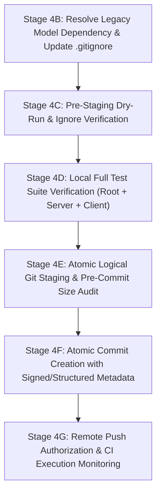

# CarSpective — Phase 21C, Stage 4A: Repository Hygiene & Safe Staging Audit

**Date:** October 15, 2026  
**Auditor:** Senior Release Engineer & Database Reliability Engineer (DBRE)  
**Status:** COMPLETE (Inspection & Planning Only)  
**Reference Document:** `docs/PHASE_21C_STAGE3B_CI_INTEGRATION_PLAN.md`  
**Target Repository:** `https://github.com/Subhamgupta9/smart-used-car-price-prediction.git`

---

## Executive Summary

A comprehensive, strictly read-only repository hygiene and source-control safety audit was conducted to prepare a safe, reproducible, and fully auditable plan for publishing CarSpective to its remote GitHub repository.

The audit verified that while local development has progressed through Phase 21 with a comprehensive, enterprise-grade architecture (FastAPI/Flask services, PostgreSQL 16 migrations, LightGBM valuation engine, React frontend, and GitHub Actions CI pipelines), the remote repository on `origin/main` currently contains **only commit `17fb04c` (`Initial commit`) with `.gitattributes` and zero application code**.

Crucially, this audit uncovered **one critical push blocker and clean-checkout risk**:
* `models/smart_used_car_price_model.pkl` is **906.95 MB (951,004,499 bytes)**, which drastically exceeds GitHub's **100 MB hard file-size limit** (`GH001`). If staged, `git push` will be immediately rejected by GitHub.
* Furthermore, the legacy prototype module `app/app.py` eagerly loads this 906.95 MB pickle file at module import time (`model = joblib.load(MODEL_PATH)`), and the root regression suite `pytest tests/` (which runs in CI) imports `app/app.py`. If this file is simply excluded without updating `app/app.py`, a clean checkout in CI will fail with `FileNotFoundError`.
* In contrast, the verified production valuation model `models/carspective_valuation_lgbm_v1.joblib` is only **2.74 MB (2,878,243 bytes)** and matches its required SHA-256 invariant hash `4a4ccf3f...`.

This audit establishes a safe, minimal ignore-rule set, candidate publishing list, explicit exclusion boundaries, and a staged remediation protocol before any files are staged or committed.

---

## 1. Repository Inventory & File Classification

The repository was inspected across all directories (excluding `.git/`, `.venv/`, and `node_modules/`). Files were categorized into nine structural classifications:

| Classification Category | File Count | Aggregate Size (MB) | Aggregate Size (Bytes) | Description / Included Paths |
| :--- | :---: | :---: | :---: | :--- |
| **Required Application Source** | 303 | 42.11 MB | 44,160,758 | `server/` (APIs, domain services, infrastructure, models, schemas), `app/` (Flask app, templates, JS experience), `src/` (stubs), `client/src/`, `scripts/` (seed & invariant tools), `adapters/` |
| **Tests and Test Fixtures** | 51 | 0.60 MB | 631,047 | `server/tests/` (39 files), `tests/` (10 files), `pytest.ini`, test fixtures |
| **CI and Build Configuration** | 10 | 0.01 MB | 15,688 | `.github/workflows/ci.yml`, `Dockerfile`, `.dockerignore`, `docker-compose.yml`, `requirements.txt`, `requirements-dev.txt`, `pyproject.toml`, `alembic.ini`, `.gitattributes`, `.gitignore`, `.env.example` |
| **Documentation & Release Reports** | 48 | 0.71 MB | 748,769 | `README.md`, `AUDIT_REPORT.md`, `GSD-STYLE.md`, `PROJECT_RULES.md`, `VERSION`, `model_capabilities.yaml`, `docs/` (Phase 1–21 reports), `data/ml_benchmarks/*.json` |
| **Required Model Artifacts** | 8 | 11.13 MB | 11,674,867 | Production model `models/carspective_valuation_lgbm_v1.joblib` (2.74 MB), manifest (2.2 KB), metadata (427 B), 5 benchmark GLB models in `models/cache/` (8.39 MB) |
| **Required Static Catalogs & Seed Data** | 4 | 4.61 MB | 4,836,076 | `data/raw/indian_used_cars_raw_57480.csv` (4.57 MB), `data/taxonomy_seeds/tier1_taxonomy_seed.json` (35 KB), `data/fixtures/current_market_listings_2026.json` (9.2 KB), `assets/vehicles/manifest.json` |
| **Local Databases & Generated Datasets** | 149 | 23.11 MB | 24,228,910 | Live SQLite database `data/database/carspective.db` (1.12 MB), pre-cleanup snapshots, safety backups, `data/processed/*.csv`, `data/phase20_load_drill/` ephemeral DBs |
| **Temporary Benchmarks, Logs & Scratch** | 333 | 15.82 MB | 16,587,853 | `scratch/` (60+ scripts, logs, test outputs), `scratch_*.txt`, root texture extraction scripts/images, `.agent/`, `.agents/`, `.gemini/`, `.gsd/` |
| **Secrets, Local Envs, Large Candidates** | 137 | 2,092.93 MB | 2,194,588,055 | `.env` (local secrets), `backup_20260928_155227/` (JS backup), `models/smart_used_car_price_model.pkl` (906.95 MB), `notebooks/models/` (906.95 MB duplicate), `models/candidates/` (277.8 MB) |
| **TOTAL INSPECTED REPOSITORY** | **1,043** | **2,191.04 MB** | **2,297,472,023** | Complete filesystem state across all non-virtualenv directories |

---

## 2. Git Safety Assessment

A rigorous inspection of the current Git state was conducted without modifying any repository state or printing remote credentials:

1. **Current Branch:** `main`
2. **Current HEAD Commit:** `17fb04c` (`Initial commit`, Author: Subham Gupta, Date: Wed Sep 16 14:11:09 2026 +0530)
3. **Tracked Files in HEAD:** Exactly 1 file:
   ```text
   .gitattributes
   ```
4. **Configured Remote:**
   ```text
   origin  https://github.com/Subhamgupta9/smart-used-car-price-prediction.git (fetch)
   origin  https://github.com/Subhamgupta9/smart-used-car-price-prediction.git (push)
   ```
5. **Remote Parity Status:**
   * **Massive Code Disparity:** `origin/main` has only `.gitattributes`. Zero application code, zero backend services, zero database migrations, zero frontend components, zero CI workflows, and zero test suites exist on the remote.
   * **Stale Branch Hazard:** Any push to `main` without prior hygiene review would upload untracked scratch files, developer prompt notes, local SQLite database binaries, temporary load test runs, and fatal > 100 MB pickle files.
6. **Operating System & Runtime:** Windows shell, Git 2.x, Python 3.11.8 (`.venv`).
7. **Git Mutation Safeguard:** No `git add`, `git commit`, `git push`, `git pull`, `git fetch`, `git reset`, `git clean`, or `git checkout` commands were executed. All checks were strictly non-mutating.

---

## 3. `.gitignore` Review & Gap Analysis

### 3.1 Existing `.gitignore` Evaluation
The current `.gitignore` contains only 23 lines:
```gitignore
# Environment and secrets
.env
.env.*
!.env.example
*.pem
*.key

# Python artifacts
__pycache__/
*.py[cod]
*$py.class
.pytest_cache/
.coverage
htmlcov/
.venv/
env/
venv/

# Node / Frontend artifacts
client/dist/
client/node_modules/
node_modules/
.npm
```

### 3.2 Comparison with `.dockerignore`
In Phase 19E, a hardened `.dockerignore` (68 lines) was implemented to protect container build contexts. However, `.gitignore` was never updated to match these standards. As a result, `git status` currently treats dozens of development artifacts as candidate untracked files.

### 3.3 Critical Gaps in `.gitignore`
The following categories of files are currently **untracked and NOT ignored** by `.gitignore`:

1. **Local Persistent SQLite Databases & WAL Files:**
   * `data/database/carspective.db` (Live active database with mutation state)
   * `data/database/carspective.db.phase19c_safety_backup`
   * `data/database/carspective.db.pre_cleanup_snapshot_20261009_191728*`
   * `*.db-shm`, `*.db-wal` (temporary SQLite write-ahead logging files)
   * *Rationale:* Binary databases in Git create perpetual merge conflicts, repository bloat, and risk leaking local transactional data. In CI, databases are ephemeral (in-memory SQLite or fresh PostgreSQL service containers initialized via Alembic).
2. **Ephemeral Load-Test & Benchmark Databases:**
   * `data/phase20_load_drill/` (138 temporary SQLite backup databases and manifests totaling 16.5 MB).
   * *Rationale:* Disposable output from Phase 20 stress testing.
3. **Scratch Scripts, Prompt Dumps & Temporary Textures:**
   * `scratch/` (60+ scratch investigation scripts and JSON profiles)
   * `scratch_phase10_prompt.txt`, `scratch_phase18.txt`, `scratch_phase5_prompt.txt`
   * `cleaned_test.png`, `extracted_texture.png`, `extract_texture.py`, `inspect_glb.py`
   * `*.log`, `*.tmp`
4. **Historical Backups:**
   * `backup_20260928_155227/` (Old frontend JavaScript backups from September 2026)
   * `*.backup*`, `*.snapshot*`, `*.safety_backup`, `*.bak`
5. **Excessive Model Candidates & Notebook Duplicates:**
   * `models/candidates/` (Contains Phase 3 candidate models, including `ExtraTreesRegressor_raw.joblib` which is 236.14 MB and violates GitHub limits)
   * `notebooks/models/` (Contains duplicate 906.95 MB pickle model)
   * `notebooks/Projects/` (Ghost empty directories)
6. **Agent & IDE Metadata:**
   * `.agent/`, `.agents/`, `.gemini/`, `.gsd/`, `.vscode/`, `.idea/` (Local IDE and agent session state)

### 3.4 Preservation of Intentionally Required Files
Per engineering instructions, **blanket ignore rules must NOT be used**:
* **Do NOT use `*.json`**: Would ignore `data/taxonomy_seeds/tier1_taxonomy_seed.json`, `data/fixtures/current_market_listings_2026.json`, `data/processed/market_intelligence_cache.json`, `models/carspective_valuation_lgbm_v1_manifest.json`, and `client/package.json`.
* **Do NOT use `*.csv`**: Would ignore canonical raw training dataset `data/raw/indian_used_cars_raw_57480.csv` required by `app/app.py` and `server/config/settings.py`.
* **Do NOT use `models/*`**: Would ignore verified production model `models/carspective_valuation_lgbm_v1.joblib` (2.74 MB) and benchmark 3D assets in `models/cache/*.glb`.

---

## 4. Proposed Minimal Ignore-Rule Changes

The following minimal, targeted additions to `.gitignore` are proposed for Stage 4B:

```gitignore
# ==============================================================================
# CARspective — Version Control Ignore Rules
# ==============================================================================

# Environment and secrets
.env
.env.*
!.env.example
*.pem
*.key
*.cert
*.crt

# Python artifacts
__pycache__/
*.py[cod]
*$py.class
.pytest_cache/
.coverage
htmlcov/
.mypy_cache/
.ruff_cache/
.venv/
env/
venv/

# Node / Frontend artifacts
client/dist/
client/node_modules/
client/.vite/
client/coverage/
node_modules/
.npm

# Persistent Databases, Backups, and Snapshots
data/database/*.db
data/database/*.db*
data/database/*.backup*
data/database/*.snapshot*
data/database/*.pre_cleanup*
data/database/*.safety_backup
*.db
*.sqlite
*.sqlite3
*.db-shm
*.db-wal
backup_*/
*.bak

# Ephemeral Benchmarks & Load Drill Artifacts
data/phase20_load_drill/
*.log
*.tmp

# Scratch & Developer Working Files
scratch/
scratch_*
cleaned_test.png
extracted_texture.png
extract_texture.py
inspect_glb.py

# Large Offline Model Candidates & Notebook Duplicates
models/candidates/
notebooks/models/
notebooks/Projects/

# IDE & Assistant Metadata
.agent/
.agents/
.gemini/
.gsd/
.vscode/
.idea/
```

---

## 5. Candidate Publish List & Explicit Exclusion List

### 5.1 Candidate Publish List (~460 Files, ~57 MB Total)
These files represent the true, reproducible, production-grade CarSpective project:

1. **Root Build & Project Configuration:**
   * `.gitattributes`, `.gitignore`, `Dockerfile`, `.dockerignore`, `docker-compose.yml`
   * `requirements.txt`, `requirements-dev.txt`, `pyproject.toml`, `alembic.ini`, `pytest.ini`
   * `README.md`, `AUDIT_REPORT.md`, `GSD-STYLE.md`, `PROJECT_RULES.md`, `VERSION`, `model_capabilities.yaml`, `.env.example`
2. **CI/CD Pipelines:**
   * `.github/workflows/ci.yml` (multi-job pipeline with security audit, SQLite tests, PostgreSQL 16 migration drill, Vite build, and prod config guards)
3. **Server Backend Source (`server/` - 119 files):**
   * Entrypoints: `server/app.py`, `server/wsgi.py`
   * Config: `server/config/settings.py`
   * Database Infrastructure & Migrations: `server/infrastructure/database.py`, `server/infrastructure/migrations/` (all 4 revision scripts)
   * Domain Services: `assistant/`, `comparison/`, `data_pipeline/`, `deal_analyzer/`, `decision/`, `discovery/`, `evidence/`, `inspection/`, `knowledge/`, `market/`, `ownership/`, `recommendation/`, `scoring/`, `taxonomy/`, `valuation/`, `workspace/`
   * Repositories, Schemas, Models, Observability, and Utilities
4. **Backend Test Suites (`server/tests/` - 39 files, `tests/` - 10 files):**
   * All unit, integration, and security tests (`test_database.py`, `test_postgresql_fixtures.py`, `test_database_url_normalization.py`, `test_phase19c_database_lifecycle.py`, `test_phase19e_deployment_and_ci.py`, etc.)
5. **Legacy Flask App & Static Assets (`app/` - 26 files):**
   * `app/app.py`, `app/market_intelligence.py`, `app/carimages_service.py`
   * Templates and static scripts (`app/templates/index.html`, `app/static/js/`, `app/static/css/`)
   * Benchmark 3D model `app/static/models/generic_car.glb` (38.82 MB, required by vehicle loader tests)
6. **Frontend Web Client (`client/` - 104 files):**
   * `client/package.json`, `client/package-lock.json`, `client/index.html`, `client/vite.config.ts`, `client/tsconfig.json`, `client/tailwind.config.js`
   * Complete React component tree, hooks, and Vitest specs in `client/src/`
7. **Production Model Artifacts (`models/` - 8 files, 11.13 MB):**
   * Verified production model: `models/carspective_valuation_lgbm_v1.joblib` (2.74 MB, SHA-256 `4a4ccf3f...`)
   * Production model manifest: `models/carspective_valuation_lgbm_v1_manifest.json` (2.2 KB)
   * Model metadata: `models/model_metadata.pkl` (427 B)
   * GLB vehicle caches: `models/cache/*.glb` (5 files, 8.39 MB)
8. **Static Data Catalogs, Seeds & Fixtures (`data/` - 49 files):**
   * `data/raw/indian_used_cars_raw_57480.csv` (4.57 MB)
   * `data/taxonomy_seeds/tier1_taxonomy_seed.json` (35 KB)
   * `data/fixtures/current_market_listings_2026.json` (9.2 KB)
   * `data/processed/market_intelligence_cache.json` (1.20 MB)
   * `assets/vehicles/manifest.json` (914 B)
   * Historical EDA summaries and benchmark JSON logs in `data/processed/` and `data/ml_benchmarks/`
9. **Utility & Governance Scripts (`scripts/` - 35 files):**
   * `scripts/generate_and_load_seeds.py`, `scripts/seed_vehicle_knowledge.py`, `scripts/backup_database.py`, `scripts/restore_database.py`, `scripts/verify_phase19_invariants.py`, `scripts/validate-*.sh`, `scripts/validate-*.ps1`
10. **Documentation (`docs/` - 42 files):**
    * Full phase documentation from Phase 1 through Phase 21C

### 5.2 Explicit Exclusion List (~583 Files, ~2.13 GB Total)
These files MUST NOT be staged or published to GitHub:

* **Secrets & Environment:** `.env`, `.env.*` (except `.env.example`).
* **Active Databases & Backups:** `data/database/carspective.db`, `data/database/*.backup*`, `data/database/*.snapshot*`, `data/database/*.safety_backup`, `data/database/*-shm`, `data/database/*-wal`, `backup_20260928_155227/`.
* **Ephemeral Load Test Outputs:** `data/phase20_load_drill/` (138 files).
* **Scratch & Prompt Files:** `scratch/` (all files), `scratch_phase10_prompt.txt`, `scratch_phase18.txt`, `scratch_phase5_prompt.txt`, `cleaned_test.png`, `extracted_texture.png`, `extract_texture.py`, `inspect_glb.py`.
* **Fatal Oversized Models (> 100 MB):**
  * `models/smart_used_car_price_model.pkl` (**906.95 MB**) — Exceeds GitHub hard limit.
  * `notebooks/models/smart_used_car_price_model.pkl` (**906.95 MB**) — Exceeds GitHub hard limit.
  * `models/candidates/ExtraTreesRegressor_raw.joblib` (**236.14 MB**) — Exceeds GitHub hard limit.
* **Non-Production Model Candidates:** `models/candidates/*` (ExtraTrees Pruned, LightGBM candidates, CatBoost, HistGradientBoosting).
* **Ghost Notebook Dirs:** `notebooks/Projects/`.
* **Virtual Environments & Node Dependencies:** `.venv/`, `client/node_modules/`, `client/dist/`, `__pycache__/`, `.pytest_cache/`.
* **Agent Framework State:** `.agent/`, `.agents/`, `.gemini/`, `.gsd/`.

---

## 6. Secret & Large-File Audit Findings

### 6.1 Secret Audit Results
1. **`.env` File Inspection:**
   * `.env` is present in the project root.
   * Key names present: `CARIMAGES_API_KEY`, `CARIMAGES_API_SECRET`.
   * Credential values were masked and NOT printed.
   * `.env` is verified as currently ignored by `.gitignore` and `.dockerignore`.
2. **Repository-Wide High-Entropy String & Credential Scan:**
   * A Python scanner inspected all non-binary files for private key blocks (`BEGIN PRIVATE KEY`), GitHub PATs (`ghp_`), Slack tokens, AWS access keys (`AKIA`), and hardcoded password assignments.
   * **Result:** **0 high-entropy secret leaks found** in tracked or candidate source files.
3. **Environment Template (`.env.example`):**
   * Verified clean. All variables use explicit dummy placeholder strings (e.g. `replace-with-a-cryptographically-secure-random-secret-key-min-32-chars`). Safe to commit.
4. **Git Remote URL Check:**
   * `git remote -v` was verified. No access tokens or user credentials are embedded in the remote URL (`https://github.com/Subhamgupta9/smart-used-car-price-prediction.git`).

### 6.2 Large-File Audit Results (> 10 MB)

| File Path | Size (MB) | Exact Bytes | GitHub Limit Status | Action Required |
| :--- | :---: | :---: | :---: | :--- |
| `models/smart_used_car_price_model.pkl` | **906.95 MB** | 951,004,499 | **FATAL (> 100 MB)** | **MUST NOT STAGE.** Exclude and remediate import dependency in `app/app.py`. |
| `notebooks/models/smart_used_car_price_model.pkl` | **906.95 MB** | 951,004,499 | **FATAL (> 100 MB)** | **MUST NOT STAGE.** Exclude via `notebooks/models/`. |
| `models/candidates/ExtraTreesRegressor_raw.joblib` | **236.14 MB** | 247,613,751 | **FATAL (> 100 MB)** | **MUST NOT STAGE.** Exclude via `models/candidates/`. |
| `app/static/models/generic_car.glb` | **38.82 MB** | 40,710,436 | **PERMITTED (< 50 MB)** | Safe to stage. Required by `tests/test_vehicle_loader.py`. Under GitHub 50 MB warning threshold. |
| `models/candidates/ExtraTreesRegressor_Pruned_raw.joblib` | **26.56 MB** | 27,852,263 | **PERMITTED (< 50 MB)** | Candidate model. Excluded via `models/candidates/` as it is not needed in production. |
| `models/carspective_valuation_lgbm_v1.joblib` | **2.74 MB** | 2,878,243 | **PERMITTED (< 50 MB)** | Verified production model. Required by CI and `server/`. Safe to publish. |

---

## 7. Missing-File & Clean-Checkout Risks

A central duty of release engineering is ensuring the **Clean-Checkout Invariant**:  
*When a developer or CI runner clones the repository from scratch on an empty machine, standard commands (`pip install`, `alembic upgrade head`, `pytest`, `npm test`, `npm run build`) must succeed without manual intervention or missing file errors.*

### 7.1 The Critical Legacy Model Blocker (`models/smart_used_car_price_model.pkl`)
* **The Conflict:**
  1. `models/smart_used_car_price_model.pkl` cannot be committed to Git because it is 906.95 MB (> 100 MB hard limit).
  2. If it is excluded via `.gitignore`, it will not be present in a clean checkout.
  3. However, `app/app.py` contains:
     ```python
     MODEL_PATH = os.path.join(BASE_DIR, "models", "smart_used_car_price_model.pkl")
     model = joblib.load(MODEL_PATH)
     ```
  4. The root regression test suite (`tests/test_ai_assistant.py`, `tests/test_cinematic_valuation.py`, `tests/test_market_intelligence.py`, `tests/test_premium_ui.py`) imports `from app.app import app`.
  5. The CI job `backend-tests` in `.github/workflows/ci.yml` executes `pytest tests/ -v`.
  6. **Consequence:** In a fresh checkout on GitHub Actions, `pytest tests/ -v` will crash at import time with:
     ```text
     FileNotFoundError: [Errno 2] No such file or directory: '.../models/smart_used_car_price_model.pkl'
     ```
* **Recommended Remediation Options for Stage 4B:**
  * **Option A (Recommended — Modernization with Backward-Compatibility):**  
    Update `app/app.py` to check for `models/carspective_valuation_lgbm_v1.joblib` (or use a lightweight wrapper) if `smart_used_car_price_model.pkl` is absent, or decouple eager model loading during testing when `TESTING=true`.
  * **Option B (Model Pruning):**  
    `models/candidates/ExtraTreesRegressor_Pruned_raw.joblib` is only 26.56 MB. If the `ExtraTreesRegressor` pipeline API is strictly expected by legacy tests, copy or symlink the pruned model (26.5 MB < 50 MB) to `models/smart_used_car_price_model.pkl`.
  * **Option C (Git LFS):**  
    Track `models/*.pkl` using Git Large File Storage (`git lfs`). *Warning:* Free GitHub accounts provide only 1 GB total storage and 1 GB/month bandwidth. A 907 MB file would consume ~90% of account quota on a single clone.

### 7.2 Static Catalogs & Seed Data Safety
* `data/raw/indian_used_cars_raw_57480.csv` (4.57 MB) and `data/taxonomy_seeds/tier1_taxonomy_seed.json` (35 KB) must be explicitly tracked. If excluded, database seeding scripts (`generate_and_load_seeds.py`) and dataset loading in `server/config/settings.py` will fail. Both files are safely included in the candidate list.

### 7.3 Frontend Build Determinism
* `client/package-lock.json` was verified present in `client/`. This ensures `npm ci` in GitHub Actions produces bit-for-bit deterministic builds matching local test runs.

---

## 8. Recommended Safe Staging Sequence with Verification Checkpoints

To ensure zero accidental data loss, zero secret leakage, and 100% CI pass rates, the following phased sequence is recommended:



### Detailed Checkpoint Protocols:

1. **Stage 4B: Address Model Blocker & Apply `.gitignore`:**
   * Select and implement the approved remediation for `app/app.py` legacy model path.
   * Update `.gitignore` with the minimal rules defined in Section 4.
2. **Stage 4C: Ignore Verification Checkpoint:**
   * Run `git status -s` and `git status --ignored -s`.
   * Assert that `data/database/carspective.db`, `data/phase20_load_drill/`, `scratch/`, `backup_*/`, and `models/candidates/` are listed under ignored (`!!`), not untracked (`??`).
   * Assert that `server/`, `client/`, `app/`, `tests/`, `models/carspective_valuation_lgbm_v1.joblib`, `.github/`, and `data/raw/` remain untracked (`??`) ready for staging.
3. **Stage 4D: Clean-Checkout Simulation & Local Verification:**
   * Run root test suite: `pytest tests/ -v` (182 tests).
   * Run server test suite: `pytest server/tests/ -v` (410+ tests).
   * Run client test suite: `cd client && npm test -- --run` (80 tests).
   * Assert 100% pass rate locally.
4. **Stage 4E: Atomic Staging in Logical Change Sets:**
   * *Set 1 — Repository Tooling & Workflows:* `.gitignore`, `.gitattributes`, `.github/workflows/ci.yml`, `Dockerfile`, `.dockerignore`, `docker-compose.yml`, `pyproject.toml`, `requirements.txt`, `requirements-dev.txt`, `alembic.ini`, `pytest.ini`, `.env.example`, `README.md`, `VERSION`.
   * *Set 2 — Core Production Backend:* `server/` (all domains, infrastructure, migrations, models, schemas, repositories).
   * *Set 3 — Production Valuation Model & Seeds:* `models/carspective_valuation_lgbm_v1.joblib`, `models/carspective_valuation_lgbm_v1_manifest.json`, `models/model_metadata.pkl`, `models/cache/*.glb`, `data/raw/`, `data/taxonomy_seeds/`, `data/fixtures/`, `assets/`.
   * *Set 4 — Legacy Application & Static Engine:* `app/`, `src/`, `scripts/`.
   * *Set 5 — Frontend Client:* `client/` (excluding `dist/` and `node_modules/`).
   * *Set 6 — Test Suites & Historical Docs:* `server/tests/`, `tests/`, `docs/`, `AUDIT_REPORT.md`, `PROJECT_RULES.md`, `GSD-STYLE.md`, `model_capabilities.yaml`.
5. **Stage 4F: Pre-Commit Hard Size Check:**
   * Query staged file sizes using `git diff --cached --name-only`.
   * Assert that **no staged file exceeds 45 MB**.
   * Assert that no files matching `*.db`, `*.key`, `*.pem`, `.env`, `scratch/`, or `backup_*/` are staged.
6. **Stage 4G: Commit & Push Authorization:**
   * Commit with clear, atomic commit message detailing the CarSpective production architecture.
   * Push to `origin/main` only upon explicit user instruction.

---

## 9. Confirmation of Zero Git Modifications

In strict compliance with the audit constraints:
1. **No Git Modifications:**
   * `git add`, `git commit`, `git push`, `git pull`, `git fetch`, `git reset`, `git clean`, and `git branch` were **NOT** executed.
   * The Git index and working tree are identical to their pre-audit state.
2. **Current Branch & Commit:**
   * Branch: `main`
   * Commit: `17fb04c Initial commit`
3. **Protected Baseline Invariant Hashes (Verified 100% Unchanged):**
   * **Live SQLite Database (`data/database/carspective.db`):**  
     `cb655c06225c07af98a85a1171595d3c0d368db4e270c3170d57f96a874209e9` (**MATCH / UNALTERED**)
   * **Valuation Model (`models/carspective_valuation_lgbm_v1.joblib`):**  
     `4a4ccf3f78c17b48826cfa55f40a24bcb808bc82fa752b793ad4eabff8b246c1` (**MATCH / UNALTERED**)
4. **Production Release Gate:**  
   * Status remains **`HOLD`** pending user review of this audit and authorization of Stage 4B remediation.
