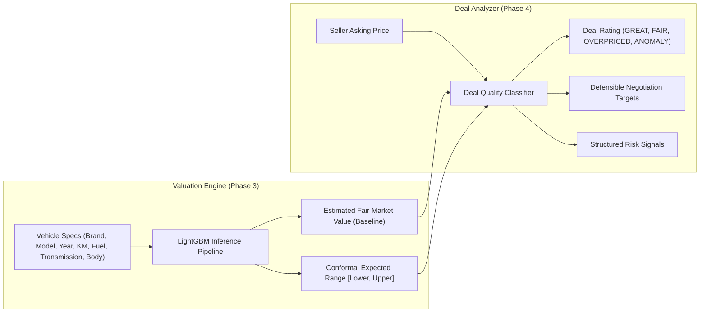
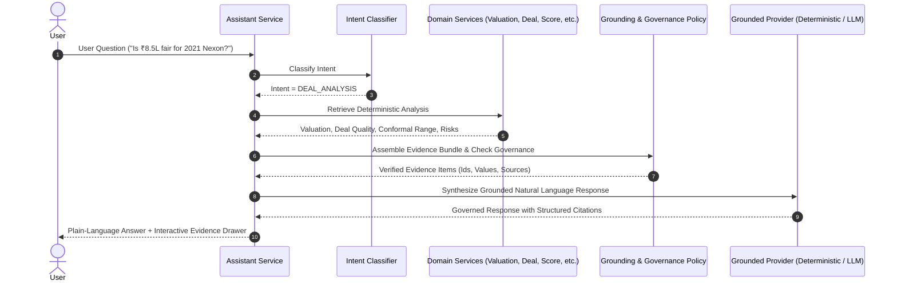

# CARspective — System Architecture & Technical Specifications

> **Core Product North Star:**  
> **Know the car. Know the value. Know the truth.**  
> *"The first automotive intelligence system built on empirical evidence, mathematical transparency, and epistemic honesty."*

---

## 1. High-Level Platform Architecture

CARspective is organized into clean architectural layers: A modern React client, a unified REST API gateway, eight isolated deterministic domain services, a relational taxonomy repository, and a cryptographic, conformal ML valuation engine.

```mermaid
graph TD
    UI["Frontend Experience (React 18 + TypeScript + Vite)"] -->|HTTP / JSON (RFC 7807)| API["API Gateway & Middleware (Flask + Request Tracing)"]
    
    subgraph "Domain Intelligence Services Layer"
        API --> TAX["Taxonomy & Identity Service"]
        API --> VAL["Valuation Domain Service"]
        API --> DEAL["Deal Analyzer Service"]
        API --> SCORE["CARspective Score Service"]
        API --> REC["Recommendation Engine"]
        API --> COMP["Comparison Engine"]
        API --> INSP["Inspection Intelligence Service"]
        API --> ASST["Grounded AI Assistant Service"]
    end

    subgraph "Analytical Truth & Storage Layer"
        TAX --> DB[(SQLite / PostgreSQL Taxonomy Store)]
        VAL --> LGBM["LightGBM Regressor (SHA-256 Verified)"]
        VAL --> CONF["Conformal Range Calibration (80% / 90%)"]
        DEAL -.->|Reads Baseline Only| VAL
        SCORE --> TAX
        REC --> SCORE
        REC --> DEAL
        COMP --> SCORE
        COMP --> VAL
        INSP --> TAX
        ASST -->|Retrieves Evidence Bundles| VAL
        ASST -->|Retrieves Evidence Bundles| DEAL
        ASST -->|Retrieves Evidence Bundles| SCORE
        ASST -->|Retrieves Evidence Bundles| COMP
        ASST -->|Retrieves Evidence Bundles| INSP
    end
```

---

## 2. Asking Price & Valuation Boundary Isolation

A foundational mathematical invariant of CARspective is that **the seller's asking price is strictly isolated from the valuation engine**. The ML model predicts the historical market asking-price baseline based purely on intrinsic vehicle attributes; it never sees what the seller is asking for the specific car.



---

## 3. Grounded AI Assistant Pipeline

The AI Assistant does **NOT** own independent analytical truth. It functions strictly as an explainability and translation layer on top of deterministic domain engines.



---

## 4. Evidence Governance & State Hierarchy

All claims and facts in CARspective are labeled with strict provenance. Evidence states can never be silently upgraded to a stronger state:

| Evidence State | Description | Authoritative Source Examples |
|---|---|---|
| **VERIFIED** | Backed by authoritative third-party documentary proof | ARAI Type Approval certificates, Global/Bharat NCAP crash tests |
| **SUPPORTED** | Manufacturer specification sheets & service manuals | Official OEM brochures, engineering spec documentation |
| **EMPIRICAL** | Computed statistically from the historical listing corpus | 57,480 historical listing dataset percentiles, resale depreciation |
| **MODEL_ESTIMATE** | Generated via conformal ML regression inference | LightGBM fair market asking-price baseline estimation |
| **INSUFFICIENT_DATA** | Insufficient data exists to formulate a safe conclusion | Out-of-distribution vehicle, missing safety testing, antique registration |
| **UNVERIFIED** | User- or seller-supplied listing claims | Seller asking price, reported cosmetic condition, unverified claims |
| **DEPRECATED** | Superseded historical information | Obsolete regulatory standards, retired trim specifications |

---

## 5. Security & Trust Architecture

1. **Model Security:** All model artifacts (`.joblib`, `.pkl`) verify cryptographic SHA-256 digests against a trusted build manifest before deserialization. Startup fails loudly upon any hash mismatch or missing manifest.
2. **API Defense-in-Depth:**
   - Path traversal prevention on static file serving (directory containment checks).
   - Structured RFC 7807 problem responses without leaking filesystem paths, server internals, or stack traces.
   - PII redaction on AI assistant conversational prompts.
3. **Observability:**
   - Every request is tagged with an immutable `X-Request-ID` UUID.
   - High-performance structured JSON logging records method, route, status, latency in milliseconds, and remote address.
